# 景区导览服务 AI 数字人 · 总体设计文档

「途叨叨」是一套通用的智能景区 AI 数字人导览方案，采用插拔式知识库架构，导入任意景区的知识库即可复用系统全部能力，本文档以灵山胜境为示范景区展开论述。本项目为第十五届中国软件杯大赛 A 组赛题（锐捷网络命题）的参赛作品。

---

# 第 1 章 引言

## 1.1 编写目的
本文档面向评审与答辩使用，阐述「途叨叨」系统的需求分析、总体架构、核心算法、数据流转、接口设计与创新点。文档重点论证两项硬性指标的达成路径，即事实性问答准确率不低于 90%、语音交互响应控制在 5 秒以内，并说明系统在规模化运营、私有化部署（景区数据不出园区）与边缘部署方面的工程能力。

## 1.2 项目背景
### 1.2.1 宏观趋势

我国旅游业正处于强劲复苏与高速增长期。据文化和旅游部数据，2025 年国内居民出游 65.22 亿人次，同比增长 16.2%，出游总花费 6.30 万亿元；较 2024 年的 56.15 亿人次（同比增长 14.8%）再创历史新高。游客规模逐年攀升，景区的接待压力与服务需求同步激增。

与此同时，国家政策明确指向旅游服务的智慧化。2024 年 5 月，文化和旅游部等五部门联合印发《智慧旅游创新发展行动计划》，鼓励支持旅游景区探索"人工智能导游"等智慧旅游创新服务；同年全国智慧旅游解决方案遴选也将"智慧导览、智慧讲解"列为重点方向。我国智慧旅游经济规模已从 2019 年的 43.29 亿元增长至 2023 年的 103.82 亿元，五年增长 1.4 倍。

由此可见，游客数量持续增多、对服务质量的要求不断提高，而传统人工导览服务在供给规模与质量上均难以匹配，这一供需矛盾正是国家以政策推动 AI 导游的根本原因，也是本项目的立项起点。

### 1.2.2 传统景区导览服务的核心痛点

在旅游人次持续攀升的背景下，传统景区导览服务的痛点可按讲解供给侧、游客侧、管理侧三类主体归纳。

**讲解供给侧。** 真人讲解资源不足。全国约 66 万持证导游，但实际与旅行社签订劳动合同的从业者仅约 16.5%，旺季与热门景区存在明显的局部性缺口，游客进入景区后常找不到讲解、跟不上团。讲解内容也偏同质，多为一套词面向所有人，难以依据游客的同行关系（亲子、老人、情侣）、兴趣偏好与停留节奏提供差异化讲解。多语种与深度讲解能力同样稀缺，外语导游仅占持证导游的约 8.4%，小语种导游长期短缺，能提供深度文化讲解的专家型导游也不足，国际游客与深度文化体验的需求难以被满足。

**游客侧。** 缺少全局人流感知与游览规划。游客无法感知景区整体客流分布，常出现某些景点拥挤、另一些景点冷清的失衡，既影响体验又埋下安全隐患，缺乏基于实时客流的游览顺序规划与错峰建议。游览过程中的情绪起伏也无人关照，排队、迷路、天气不适等情形下游客难免产生焦躁、失落等情绪，传统导览难以及时安抚。此外，游客抵达某一景点时往往需要即时的针对性讲解，并区分游客身份（带孩子时讲故事、陪伴老人时放慢节奏）作个性化输出，而真人导游难以规模化覆盖这类需求。

**管理侧。** 游客反馈难采集、服务质量难量化。景区管理方缺乏及时了解游客真实感受的便捷手段，难以量化评估导览服务质量，无法形成反馈到改进的闭环。突发情况也难以及时感知与上报，景区人流密集，拥挤、求助、投诉等情况不可避免，传统模式下缺乏从游客端到管理端的实时反馈通道，管理方难以第一时间发现并处置。

### 1.2.3 本项目的回应

针对上述痛点，本项目构建景区导览服务 AI 数字人系统，提供可全天候服务、边际成本低、可个性化、可量化的导游能力，对三侧痛点逐一回应。

针对讲解供给侧，系统以 RAG 智能问答、多同行人格与多语言能力，提供无限量、可按游客身份差异化、支持多语种的专业讲解。针对游客侧，系统以实时人流感知分流、时间天气感知与情绪安抚意图，主动给出错峰路线与情绪关怀。针对管理侧，系统以会话情感分析、数据大屏、游客感受度报告与负面情绪及突发预警，为管理方建立实时感知、量化评估、闭环优化的能力。

系统采用插拔式知识库架构，导入任意景区的知识库即可复用全部能力，不绑定单一景区，具备规模化推广价值。

在此基础上，本系统形成六项核心特色：插拔式知识库与可量化的准确率承诺、自主设计的 EA-RAG 检索算法、由客流与天气等情境主动触发的导游服务、因人而异的个性化讲解、实时数字人的自然度工程，以及面向规模化运营的成本架构与双端运营闭环。

**本节数据来源**

- [文化和旅游部：2025 年国内居民出游 65.22 亿人次（新华网）](https://www.news.cn/20260126/8dda85c98d8843e69b256cea591a7d8b/c.html)
- [2024 年度国内旅游数据情况（文化和旅游部）](https://zwgk.mct.gov.cn/zfxxgkml/tjxx/202501/t20250121_958012.html)
- [《智慧旅游创新发展行动计划》（中国政府网）](https://www.gov.cn/zhengce/zhengceku/202405/content_6950881.htm)
- [2024 年全国智慧旅游解决方案推荐遴选通知（文化和旅游部）](https://zwgk.mct.gov.cn/zfxxgkml/zykf/202410/t20241009_955624.html)
- [导游证报考激增，存在局部性缺口（新京报）](https://www.bjnews.com.cn/detail/1733916660129950.html)
- [月入两万不及以前一半，小语种导游仍然"无人可用"（大众日报）](https://m.dzplus.dzng.com/share/general/0/NEWS1128806CCXHYWVXDLEVX)
- [景区敞开大门迎客，旅游体验如何保障（新华网）](http://www.news.cn/politics/20240625/6a9f5cf8fd524468a5548068e40f188a/c.html)

## 1.3 术语与缩略语

下表汇总全文反复出现的核心术语与缩略语，按所属子系统分组排列，便于评审检索对照。

**表 1-1　术语与缩略语对照**

| 术语 / 缩写 | 全称 | 说明 |
|---|---|---|
| RAG | Retrieval-Augmented Generation | 检索增强生成；先从知识库检索再交大模型生成，是本系统问答准确率的基础范式|
| LLM | Large Language Model | 大语言模型；本系统采用通义千问 Qwen 系列 |
| 向量嵌入 | Embedding | 将文本映射为高维语义向量以计算相似度，本系统用 BGE-M3 |
| 重排序 | Rerank | 对初步召回结果二次精排以提升命中率，本系统用 BGE-Reranker-v2-m3 |
| BM25 | Best Matching 25 | 基于词频的稀疏检索算法，与稠密向量检索互补 |
| ChromaDB | — | 开源向量数据库；按景区分 collection 实现知识库命名空间隔离 |
| Ditto | — | 实时全脸驱动引擎，本系统数字人直播主引擎|
| MuseTalk | — | 实时口型生成模型，本系统第一代数字人引擎 |
| TensorRT | — | NVIDIA GPU 推理加速库，用于 Ditto 实时化 |
| LiveTalking | — | 数字人音视频推流框架 |
| SSE | Server-Sent Events | 服务端事件流；服务端向浏览器单向流式推送，用于问答逐句返回 |
| TTS / ASR | Text-to-Speech / Automatic Speech Recognition | 语音合成 / 语音识别 |
| 口型同步 | Lip Sync | 数字人嘴型与输出语音逐帧对齐 |
| Erlang-C | — | 排队论容量公式，用于多 GPU 池容量测算|
| CHBL | Consistent Hashing with Bounded Loads | 一致性哈希有界负载；多 GPU 分发算法，兼顾 avatar 亲和与负载均衡 |

## 1.4 参考资料
赛题文档、文旅部公开数据、开源项目（BGE-M3、BGE-Reranker、Ditto、MuseTalk、LiveTalking、Qwen 系列），以及 HeyGen、Synthesia、讯飞、百度曦灵等商用数字人产品的形象库分类法。各章末另附专项文献。

---

# 第 2 章 需求分析

本章将赛题要求拆解为可验证的需求条目。首先概述赛题与硬性指标（2.1），再按用户角色展开用例（2.2），继而给出功能性需求（2.3）与非功能性需求（2.4）的逐条对照，每条需求均标注其在系统中的实现载体（接口或模块），形成需求到实现的可追溯矩阵；最后以统一的预期输入与预期输出契约定义各算法模块的需求边界（2.5）。

## 2.1 赛题需求概述

本课题为第十五届中国软件杯 A 组赛题"景区导览服务 AI 数字人"（出题企业：锐捷网络），要求面向景区游客与管理方构建 AI 数字人导览系统，并以灵山胜境与拈花湾为示范景区，提供公开资料包（游览指南、景点结构化数据集、14 万行游客行为数据）。

赛题的核心要求可归纳为三层。

游客交互层：支持语音与文本输入，数字人以语音、表情、口型同步的方式回答，提供历史、文化、景点特色的智能问答与个性化路线推荐。

管理层：知识库上传、更新与维护，数字人形象（外观与声音）配置，游客感受度报告，数据大屏概览。

质量层（评审红线）：问答准确率不低于 90%，这是赛题中唯一带数值的硬性指标；交互响应延迟控制在合理范围，赛题以语音问答延迟小于 5 秒为例；口型同步与表情自然；至少使用 1 个多模态大模型；系统稳定不崩溃。

在赛题要求之外，本系统增加一条架构级约束，源自"知识库管理"要求的深层含义：系统不绑定任何特定景区，导入任意景区的知识库后，问答准确率须同样达标。

## 2.2 用户角色与用例分析

系统服务两类角色，其用例全景见**图 2-1**。

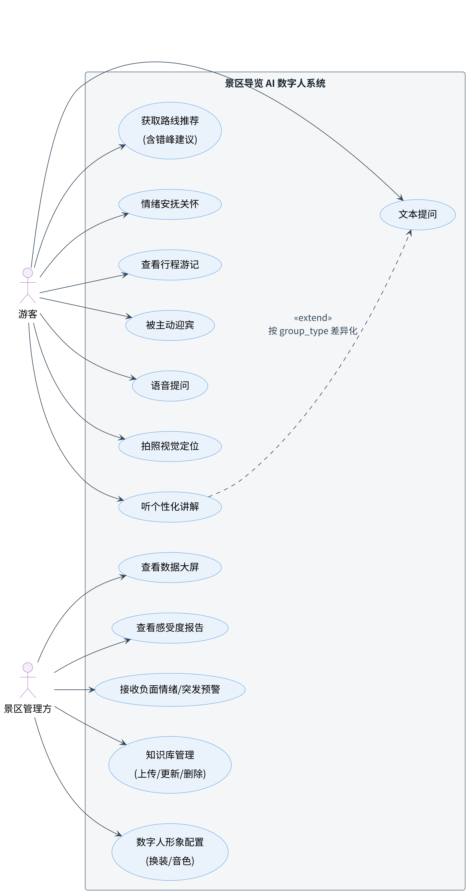{ width=84% }

**图 2-1　系统用例图**

**表 2-1　用户角色与使用环境**

| 角色 | 描述 | 使用环境（实际形态） |
|---|---|---|
| 游客 | 在景区游览过程中寻求讲解、问路、推荐与帮助的个人 | 手机浏览器网页（iOS Safari 走 HLS、安卓 Chrome 走 FLV）；规划中的安卓 APK |
| 景区管理方 | 负责景区运营、内容维护与服务质量监控的工作人员 | 桌面端网页（含数据大屏） |

游客侧用例共 8 项：文本提问、语音提问、拍照视觉定位、听个性化讲解（按同行人格差异化）、获取路线推荐（含错峰建议）、情绪安抚关怀、被主动迎宾、查看行程游记。

管理侧用例共 5 项：知识库管理（上传、更新、删除）、数字人形象配置（外观与音色）、查看数据大屏、查看游客感受度报告、接收负面情绪与突发预警。

典型场景按如下顺序串联：游客打开页面，数字人主动迎宾并自我介绍；游客拍摄大佛照片，系统视觉定位"您正在大佛广场"并接地讲解；游客带孩子时，系统以亲子人格讲故事并提示母婴设施；询问路线时结合实时客流与天气给出错峰建议；游览结束生成电子游记。全程对话情绪入库，管理方在大屏看到热点话题与情感趋势，负面情绪触发预警。

## 2.3 功能性需求

需求按角色编号，FR-T 为游客端，FR-M 为管理端，每条标注实现载体，同时构成需求到实现的追溯矩阵。

### 游客端

**表 2-2　游客端功能性需求**

| 编号 | 需求描述 | 实现载体 |
|---|---|---|
| FR-T1 | 文本提问，获得基于景区知识库的准确回答 | `POST /chat`（同步 + SSE 流式） |
| FR-T2 | 语音提问：录音自动断句、转写为文字后进入问答 | 前端能量 VAD + `POST /asr`（faster-whisper，~1.1s/句） |
| FR-T3 | 数字人以语音+口型同步+表情回答，回答与情绪联动 | LiveTalking + Ditto 全脸实时驱动（25.5fps）；`[情绪:X]` 联动 TTS 韵律（语速）与 Ditto 原生情绪表情条件 |
| FR-T4 | 拍照视觉定位：拍摄景物 → 识别所在位置 → 接地讲解与指路 | `POST /chat/image` 两段式（qwen-vl 认地标 → RAG 接地生成） |
| FR-T5 | 个性化讲解：按同行关系切换叙事人格 | `group_type` 参数（成人/亲子/老年/情侣 四种人格指令） |
| FR-T6 | 个性化路线推荐，结合实时客流与天气给出错峰/避雨建议 | navigation/recommend 意图 + 客流模型（14 万行真实行为数据）+ 天气感知（wttr.in） |
| FR-T7 | 多语言问答：自动跟随提问语言或强制指定 | `lang` 参数（auto/zh/en/ja/ko/fr/de/es/ru，共 9 档） |
| FR-T8 | 主动迎宾：连接后数字人主动打招呼、自我介绍、邀请互动 | `GET /trip/greeting`（按景区导游名+人格差异化） |
| FR-T9 | 行程总结：生成本次游览的温暖游记回顾 | `GET /trip/summary`（引用会话史含拍照定位点） |
| FR-T10 | 情绪安抚：识别游客负面情绪并给予关怀回应 | empathy 意图路由 + 共情指令 |
| FR-T11 | 自身情况画像：按年龄、节奏、出行方式、目的、是否初访因人而异讲解 | 五维 Situation 模型注入讲解指令；与 group_type 正交；全默认时缓存键与准确率不受影响 |
| FR-T12 | 跨设备接力与同游：扫码把对话与画像带到另一台设备无缝接续 | `POST /handoff/create`、`POST /handoff/claim`、`GET /handoff/qr.png`（一次性令牌，TTL 5 分钟） |

### 管理端

**表 2-3　管理端功能性需求**

| 编号 | 需求描述 | 实现载体 |
|---|---|---|
| FR-M1 | 知识库上传、查询、删除；上传后即时生效 | `POST /kb/upload`、`GET /kb/list`、`DELETE /kb/{id}`（入库自动失效答案缓存与实体索引） |
| FR-M2 | 多景区知识库隔离：新增景区不影响既有景区 | ChromaDB 多 collection 命名空间（`scenic_{id}`） |
| FR-M3 | 数字人形象配置：按景区配置外观与音色 | `GET/PUT /digital-human/config`；AI 换装生成链路（ComfyUI + InstantID 锁脸换装） |
| FR-M4 | 数据大屏：会话量、热点话题、情感趋势可视化 | `GET /analytics/dashboard`、`hot-topics`、`sentiment-trend` |
| FR-M5 | 游客感受度报告：基于会话数据自动生成 | `POST /analytics/report`（LLM 生成） |
| FR-M6 | 负面情绪预警与知识盲区发现 | `GET /analytics/alerts`、`GET /analytics/knowledge-gaps` |

## 2.4 非功能性需求

每条 NFR 给出实测值，数据来源为第 4 章的可复现评测：

**表 2-4　非功能性需求与实测对照**

| 编号 | 需求 | 指标要求 | 实测值 | 结论 |
|---|---|---|---|---|
| NFR-1 | 问答准确率 | ≥ 90%（硬性红线） | 97.1%（105 题严格自动评分；人工复核 100%；5 景区分别 94.3~100%） | 达标 |
| NFR-2 | 语音问答响应延迟 | 合理范围（赛题例：<5s） | 端到端（说完到数字人开口）约 4.4s（Ditto 配置），即 VAD 0.5 + ASR 1.0 + RAG 首句 1.8(p95) + TTS 首块 0.35 + 渲染首帧 0.72 | 达标 |
| NFR-3 | 多模态大模型 | ≥ 1 个 | qwen3-vl-plus（视觉定位）与 qwen-plus（文本），构成多模态语料闭环 | 达标 |
| NFR-4 | 口型同步与表情自然 | 专家评估 | Ditto 全脸实时驱动（头、眼、颊、嘴协同，720×1280 全分辨率，25.5fps）；待机微动由模型自生成，待机与说话之间无硬切；情绪标签联动语音韵律与全脸表情 | 演示视频呈现 |
| NFR-5 | 抗幻觉/可信度 | （自加强化） | 陷阱题拒答纠错 100%（15/15）；EA-RAG 置信度门控经标定（库外拒答 60%、零误拒） | 达标 |
| NFR-6 | 景区无关性（插拔式） | 换库后仍达标 | 5 个景区（灵山、拈花湾、西湖、黄山、故宫）全部不低于 90%，新景区仅需上传文档 | 达标 |
| NFR-7 | 稳定性 | 不崩溃、无长时无响应 | 逻辑后端无状态、可进程守护常驻提供持续服务；客流高峰或弱网导致渲染满载、数字人离线时自动降级为文字答复，保证人人有答复；本地演示态显存余量约 8.9GB（Ditto 引擎仅占 2.7G） | 达标 |
| NFR-8 | 端兼容性 | 手机可用 | iOS Safari（HLS）与安卓 Chrome（HTTP-FLV）双路自适配；麦克风经 HTTPS 授权 | 达标 |

关于 NFR-2 的口径说明：赛题原文将"<5 秒"作为"合理范围"的示例而非硬性定值（唯一带数值的硬性指标是准确率）。本系统仍将其作为工程目标，并采用对体验最严格的端到端口径，即从游客说完最后一个字到数字人开口的时间。其中首句开口由逐句流式架构保证，答案边生成边播报，整段时长不影响感知延迟。

## 2.5 算法需求

各算法模块以统一的预期输入与预期输出契约定义需求边界，这也是前后端协作的接口依据。

① RAG 智能问答
- 预期输入：会话标识、用户消息、景区标识，以及可选的同行人格、语言、是否流式等参数。
- 预期输出：口语化且不含 Markdown 的回答文本、情绪标签（6 类）、意图标签（5 类）、来源与所用上下文；流式时依次下发意图、情绪、多条句子、结束事件。
- 质量约束：准确率不低于 90%；知识库无答案时必须兜底拒答，不得编造。

② 意图分类
- 预期输入：用户问句与对话历史。
- 预期输出：问答、导航、推荐、共情、闲聊五类之一。
- 质量约束：高频问题由规则即时命中；分类失败时安全回退为问答类。

③ 多模态视觉定位
- 预期输入：景物照片、可选的文字问题与景区标识。
- 预期输出：识别出的景点位置（无法识别时为空）与接地讲解和指路文本。
- 质量约束：地标识别置信不足时不得武断定位，转为通用讲解并引导。

④ 语音识别
- 预期输入：16kHz 单声道音频。
- 预期输出：中文文本，含景区专名纠错。
- 质量约束：单句转写不超过 1.5s；优先保证生僻专名（如九龙灌浴、梵宫）的识别正确率。

⑤ 语音合成与数字人驱动
- 预期输入：文本句、情绪标签与决定音色的景区标识。
- 预期输出：音频流与约 25fps 的口型同步视频流。
- 质量约束：按句驱动，首句即开口；情绪切换在句间安全点原子生效。

⑥ 客流感知
- 预期输入：景区标识与当前时间。
- 预期输出：拥挤档位（空闲、适中、较多、繁忙）、旺淡季判断与错峰时段建议。
- 质量约束：基于 14 万行真实行为数据的统计模型；数据缺失时优雅降级，不阻塞主流程。

⑦ 情感分析与运营报告
- 预期输入：含情绪标注的会话记录。
- 预期输出：大屏指标（热点话题与情感趋势）、感受度报告、负面预警与知识盲区清单。
- 质量约束：异步统计，不增加问答链路延迟。

## 2.6 本章小结

本章将赛题要求落为 18 条功能性需求，全部有实现载体可追溯，以及 8 条非功能性需求，其中 7 条已有实测数据支撑，并以输入输出契约固化了 7 个算法模块的边界。其中 NFR-6 景区无关性是贯穿全文的设计主线，使系统从面向单一景区的导览扩展为任意景区可即插即用的导览平台，后续章节的架构与算法设计均围绕此展开。

---

# 第 3 章 总体设计

## 3.1 技术选型

本系统的技术选型遵循计算与渲染解耦的原则。问答、检索、分析与配置等逻辑计算并不依赖 GPU，只有数字人的实时渲染必须占用 GPU，因此将二者在物理上分离。在此前提下，技术栈自上而下分为游客端、接入层、应用层、渲染层与数据层五部分。

游客端用于承载文本、语音、拍照三种输入以及数字人画面的播放，采用 React、Vite 与 Tailwind 构建手机网页，配合 shadcn/ui 组件库保证界面观感；为兼容不同机型，iOS 走 HLS、安卓走 FLV 两种直播协议。接入层用于统一收口前端与两个异构后端，采用自研桥接层，负责订阅问答的句子级流并逐句驱动数字人、在容量满载时降级为文字答复，以及为绕开媒体服务器的跨域限制而反向代理直播流。应用层承载问答、多智能体、情境感知、视觉定位、行程关怀与分析配置等全部逻辑计算，以 FastAPI 为基础实现，向量嵌入交由云端服务完成，因而整层不占用 GPU。

问答引擎是应用层的核心，采用检索增强生成（RAG）路线：用 BGE-M3 做稠密向量检索、rank_bm25 做稀疏关键词检索，二者混合后由 BGE-Reranker-v2-m3 精排，再交由大模型生成口语化答复。文本大模型按意图分流，事实问答用 qwen-plus 以守住准确率，生成性意图用 qwen-flash 以压低时延；多模态识别用 qwen3-vl-plus，既满足赛题"至少一个多模态大模型"的硬性要求，又支撑拍照认地标。

渲染层用于把答复呈现为可动可说的数字人，采用 LiveTalking 框架接入 Ditto 驱动引擎并经 TensorRT 实时化；语音合成用云端 Qwen-TTS，不占本地 GPU，语音识别用 faster-whisper 并内置景区术语纠错。数据层用于存储向量、会话与统计源，采用 ChromaDB，以多 collection 为每个景区划分独立命名空间，这是插拔式知识库的基础；会话、事件与配置等结构化数据用 SQLite 存储，初赛单机零运维，规模化时可平滑迁移至 PostgreSQL。

上述各模块的选型理由与实测依据汇总如表 3-1 所示。

**表 3-1　技术选型与实测依据**

| 模块 | 选型 | 为何适合本任务 | 数据佐证（实测） |
|---|---|---|---|
| 文本 LLM | qwen-plus（DashScope，qa）/ qwen-flash（生成性意图）| 中文理解强的商业模型；qa 用 plus 在准确率与延迟间取最优 | qa 准确率 97.1%；首句 p95 1.8s |
| 多模态 LLM | qwen3-vl-plus | 满足"≥1 多模态大模型"硬指标；拍照认地标 | 两段式视觉定位，事实由知识库约束 |
| 向量嵌入 | BAAI/bge-m3（本地）/ DashScope 嵌入（云） | 中英双语、检索质量高；云端版 0 GPU，与本地同向量空间 | GPU 加速后检索 0.54s（原 30s）|
| 重排序 | BAAI/bge-reranker-v2-m3 | 交叉编码精排，是把准确率推过 90% 的关键一环 | 含重排的完整链路较裸模型消融提升 56.1 个百分点|
| 向量库 | ChromaDB | 多 collection 实现景区命名空间隔离，是插拔式的基础 | 8 景区各一 collection；其中 5 景区经 105 题完整评测均 ≥90% |
| 稀疏检索 | rank_bm25（字符级）| 与稠密检索混合，兜底专名与数字的精确匹配 | 混合检索覆盖"五明桥""佛足坛"等冷门专名 |
| 数字人 | LiveTalking + Ditto（TensorRT）| "驱动原图"范式使全脸表情协同自然；文字驱动接口直接对接 RAG | 25.5fps 实时、首帧 719ms、显存仅 2.7G|
| 语音 | Qwen-TTS-Flash（TTS）/ faster-whisper（ASR，自研景区术语纠错）| 云端 TTS 不占本地 GPU；ASR 内置景区术语纠错 | TTS 首音 0.35s 实测；ASR 约 1.1s/句 |
| 前端 | React + Vite + Tailwind + shadcn/ui | 商业级组件库与设计 token，保证界面专业观感 | 沉浸式三模态交互页，支持深色与多语言换肤 |
| 数据库 | SQLite（会话/事件/配置）+ ChromaDB（向量）| 初赛单机足够、零运维；规模化可平滑迁移 PostgreSQL | 会话、事件、主题、形象四表，支持幂等迁移 |

## 3.2 系统架构

综合上述选型，并遵循计算与渲染解耦的原则，得出如图 3-1 所示的系统总体架构。

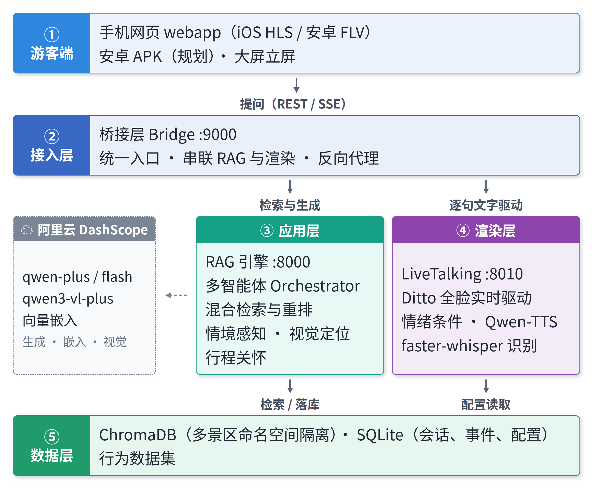{ width=81% }

**图 3-1　系统总体架构（分层解耦）**

本系统自上而下分为五层，各层职责单一。游客端为手机网页，向上提供文本、语音、拍照三模态输入与数字人画面播放，本身不需 GPU。接入层即桥接层，是游客端唯一对接的地址，统一完成流式反向代理、容量调度、高频问答缓存命中与满载降级。应用层为 RAG 后端，承载问答、多智能体、情境感知、视觉定位、行程关怀、数据分析与形象配置等逻辑，因向量嵌入走云端而同样不占 GPU。渲染层由 LiveTalking、Ditto 与 Qwen-TTS 组成，完成全脸口型驱动、语音合成与推流，是全系统唯一占用 GPU 的部分。数据层包含向量库 ChromaDB、关系库 SQLite 与客流统计源，分别支撑多景区隔离的检索、会话与配置存储以及人流分析。

桥接层独立成层，是因为它处在游客端与逻辑后端、GPU 后端两个异构服务之间的唯一收口位置。把流式订阅、容量调度与跨域代理等编排逻辑集中到这一层，前端只需对接一个地址，三方边界清晰、可独立演进。

系统整体采用插拔式知识库、计算与渲染解耦、主动式情境感知、三层漏斗可规模化的设计理念。导入任意景区的知识库即可零改动复用，准确率同样不低于 90%；逻辑计算与 GPU 渲染物理分离，逻辑后端常驻廉价无卡服务器，GPU 仅在数字人开口时被占用，以此压低成本；导览方式由被动的等待提问，升级为由空间、时间、人流与天气主动触发；并通过三层漏斗架构，在保证每位游客都能及时获得答复的同时，把运营成本压到显著低于真人导游。

## 3.3 部署架构

部署沿用计算与渲染解耦的理念，同一套代码支持两种形态，如图 3-2 所示。

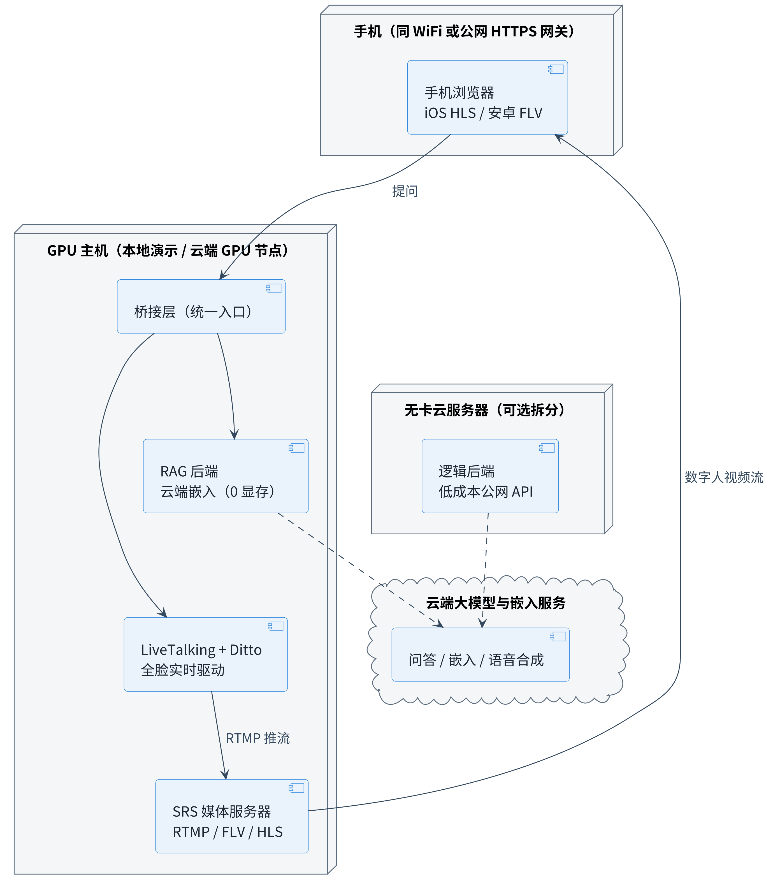{ width=96% }

**图 3-2　部署架构（本地全栈与云端公网两种部署形态）**

一是本地全栈，在一台 GPU 主机上运行全部服务，同一 WiFi 下手机即可访问，用于开发与演示，无云成本；二是云端公网，将全栈部署在云端 GPU 节点，经统一网关对外提供访问，支持扫码即用与评审自助测试。两种形态共用同一套代码，向量嵌入来源（本地 GPU 模型或云端嵌入服务）经配置切换，互不影响。

逻辑后端不依赖 GPU，经云端嵌入完成向量化，可部署在廉价的无卡云服务器上常驻，提供低成本的公网问答接口；数字人渲染则部署于 GPU 节点，桥接层、LiveTalking 与媒体服务器置于同一台机器，单个 GPU 节点即可独立支撑全栈。两类节点分工明确：云服务器常驻提供低成本门面，GPU 节点按需启用以控制渲染成本。

若把向量嵌入改用本地 BGE-M3、不再依赖外部云，问答、渲染、会话与配置数据均可落在景区本地，做到数据不出园区，契合文旅与政企场景的数据合规诉求。规模化时，逻辑后端可通过多 worker 加负载均衡、并将 SQLite 迁移至 PostgreSQL 实现水平扩展，数字人渲染则由三层漏斗架构支撑。

---

# 第 4 章 算法设计

景区导览对智能问答提出五方面要求：答得准、答得懂游客与情境、像真人、响应快、可规模化运营。本章的算法设计围绕这五方面展开，各节与对应交付如表 4-1 所示。

**表 4-1　本章结构与核心交付**

| 关注的问题 | 对应小节 | 核心交付（实测） |
|---|---|---|
| 答得准、不编造 | 4.1 RAG 引擎（含自主设计的 EA-RAG 与质量评测） | 准确率 97.1%（人工复核 100%），陷阱拒答纠错 100% |
| 懂游客、懂情境 | 4.2 多智能体与人格、4.3 空间情境感知、4.4 视觉定位 | 五类意图分派、四种同行人格、客流与天气时间注入、拍照即定位 |
| 像真人导游 | 4.5 数字人驱动引擎与自然度 | Ditto 全脸驱动 25.5fps 实时、情绪表情联动 |
| 响应及时 | 4.6 语音链路与延迟优化 | 语音端到端约 4.4s（小于 5s），RAG 首句 p95 1.8s |
| 可规模化运营 | 4.7 并发与成本规模化、4.8 GPU 池调度 | 单游客成本低于 1 元，满载降级保人人有答案 |

准确率是其中唯一带明确数值的硬性指标，是系统的底线；其余四项决定体验质量与能否投入运营。各节按统一结构展开：问题背景、方案选型（含对比数据）、底层原理、工程实现、实测验证，并各设一节诚实边界，明确每项技术的能力范围，避免夸大。

## 4.1 RAG 智能问答引擎

景区导览的智能问答以检索增强生成（Retrieval-Augmented Generation, RAG）为核心：让大模型在回答前先从景区知识库中检索相关事实，做到开卷作答而非凭记忆推测。本节依次说明总体框架、基座选型、逐层原理（含自主设计的 EA-RAG 检索算法）、工程优化与质量评测，并给出准确率 97.1%、首句延迟 1.8s 的实测依据。

### 4.1.1 RAG 的必要性

大模型直接用于景区问答有三处缺陷。一是知识盲区，"五明桥的尺寸""佛足坛的规模"这类冷门细粒度事实不在其预训练语料中。二是幻觉，被问到不确定信息时模型倾向于编造看似合理的答案（如把灵山大佛高度说成约 101 米），在导游场景中后果严重。三是无法更新，景区票价、开放时间等信息会变化，重新训练大模型成本过高。

RAG 同时解决这三者：把景区知识存入可检索的外部知识库，回答前先检索，再把检索结果作为参考资料交给大模型。知识盲区由检索补全，幻觉由"只依据资料回答"的约束抑制，信息更新只需替换知识库文档。这也是赛题"插拔式知识库"要求的技术落点，更换景区即更换知识库，算法链路无需改动。

一组消融实验量化了 RAG 的价值：关闭检索后，同一系统的准确率从 97.1% 降至 41.0%，这 56 个百分点即 RAG 的贡献。

### 4.1.2 总体框架

系统的问答全链路如图 4-1 所示，自游客提问到逐句流式输出分为八个阶段：多智能体路由、答案缓存、查询改写、混合检索、重排序与置信度门控、Prompt 组装、大模型生成、情绪解析与落库。各阶段的原理随后依次说明。

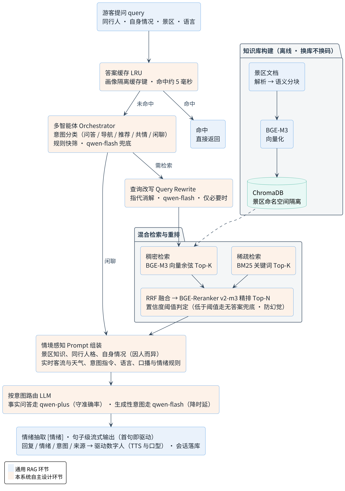{ width=99% }

**图 4-1　RAG 问答全链路：蓝色为通用环节、橙色为本系统自主设计**

链路的设计可归纳为三点：以混合检索召回加交叉编码精排保证检索准确，以 Prompt 强约束加召回兜底保证不偏离事实，以 LRU 缓存、并行检索与逐句流式保证响应迅速。

### 4.1.3 基座选型与理由

每个组件的选型都按"是什么、为何适合本任务、有何数据佐证"说明，下分向量嵌入、重排序与生成模型三部分。

**向量嵌入模型：BAAI/BGE-M3**

**表 4-2　向量嵌入模型候选对比**

| 候选 | 取舍 |
|---|---|
| OpenAI text-embedding | 需海外 API、有费用、数据出境合规风险 |
| text2vec / m3e | 中文尚可，但多语种与长文本偏弱 |
| BGE-M3（选定） | 智源开源，中英双语检索质量领先，支持 8192 长上下文，可本地部署、零 API 费用；输出 1024 维稠密向量 |

选择理由在于：景区知识含大量中文专名与少量外文（面向国际游客），BGE-M3 的中英双语能力正好契合；本地运行（RTX 4080）则规避了 API 费用与数据合规问题。部署到无 GPU 的云服务器时，可无缝切换为效果相近的 DashScope text-embedding-v3，仅需通过 deploy_mode 配置切换。

**重排序模型：BAAI/BGE-Reranker-v2-m3**

这是把准确率从"能用"推到 90% 以上的关键一环。选型理由在于：与 BGE-M3 同源、支持中英双语、交叉编码精度高、可本地以 fp16 半精度运行（节省显存并提速）。

**生成大模型：qwen-plus（事实问答）+ qwen-flash（生成性意图）**

这是一处经过实测权衡的工程决策，而非随手选型：

**表 4-3　生成模型选型对比**

| 模型 | 生成速度 | 用途 | 理由 |
|---|---|---|---|
| qwen-max | 约 20 字/s | （备选） | 质量最高但偏慢，流式首句约 3s |
| qwen-plus（选定，qa） | 约 48 字/s | 事实问答 | 速度约为 max 的 2 倍，流式首句约 1.2s，是压住语音 <5s 的关键；事实已由 RAG 检索结果约束，质量足够 |
| qwen-flash（选定，生成性意图） | 最快 | 路线、推荐、安抚、闲聊 | 这些意图不在准确率测试集范畴，更看重生成的流畅与速度 |

这一决策的依据在于：在 RAG 架构下，事实正确性由检索保证，大模型只负责组织语言。因此可以为生成模型选择"更快而非最强"的档位，这正是 RAG 将"知识"与"表达"解耦后释放出的优化空间。

### 4.1.4 知识库构建

RAG 的质量从知识"入库"那一刻就开始决定。

**文档解析与"双策略"分块**

知识库文档有两种形态，本系统针对性地采用不同的分块策略：

- **叙述性文档**（《游览指南》）：按段落聚合，相邻 chunk 保留 128 字重叠（chunk 大小为 512），避免把一句话从中切断导致语义断裂。
- **结构化表格**（《景点结构化数据集》）：每一行（即一个景点）独立成块，并把单元格拼成"字段名: 值"的格式（如"建筑参数: 长 39.8m，高 7m"）。

实现中的问题与解决：早期把表格按普通文本流式分块，导致"灵山大佛的高度"可能与"梵宫的面积"被切进同一 chunk，检索时出现张冠李戴。改为逐行成块并保留字段名后，每个景点的事实自成一个语义完整、互不污染的检索单元，这是结构化景区数据准确率较高的重要原因。

**向量化与命名空间隔离**

每个 chunk 经 BGE-M3 编码为 1024 维归一化稠密向量，存入 ChromaDB。这里的关键设计是多 collection 命名空间隔离：每个景区独占一个 collection（如 `scenic_lingshan`、`scenic_xihu`），检索时只在目标景区的命名空间内进行。这从数据层面实现了"插拔式知识库"，新增景区即新建一个 collection，彼此互不干扰，也避免了陷阱测试中"跨景区串问"的污染。

### 4.1.5 检索、重排与生成

**混合检索：稠密召回语义，稀疏兜底专名**

单一检索方式都有盲区，本系统采用稠密与稀疏两路并行：

- **稠密检索（语义）**：query 经 BGE-M3 编码，在 ChromaDB 中以余弦相似度召回语义最近的 Top-10。它能理解"大佛多高"与"佛像高度"这类同义改写，但对生僻专名不敏感。
- **稀疏检索（关键词）**：BM25 算法按词频精确匹配召回 Top-10。它对"九龙灌浴""鲫鱼背"这类专有名词精准命中，而这恰是稠密向量的弱项。

两路的打分函数如下。稠密路计算 query 与文档向量的余弦相似度（BGE-M3 输出向量已归一化，故等价于内积）：

$$
\text{sim}(q,d)=\cos(\mathbf{e}_q,\mathbf{e}_d)=\frac{\mathbf{e}_q\cdot\mathbf{e}_d}{\|\mathbf{e}_q\|\,\|\mathbf{e}_d\|}
$$

稀疏路用 BM25 按词频与逆文档频率打分，其中 $f(t,d)$ 为词 $t$ 在文档 $d$ 中的频次，$|d|$ 为文档长度，$\text{avgdl}$ 为平均文档长度，参数取 $k_1=1.5$、$b=0.75$：

$$
\text{BM25}(q,d)=\sum_{t\in q}\text{IDF}(t)\cdot\frac{f(t,d)\,(k_1+1)}{f(t,d)+k_1\big(1-b+b\,\frac{|d|}{\text{avgdl}}\big)}
$$

在工程实现上，中文 BM25 采用字符级切分而非依赖分词器，既规避了分词错误，又对未登录的景区专名天然鲁棒。

两路结果去重融合为候选集。语义与关键词互补，是召回率（不漏）的保障。

**重排序：从召回到精排**

混合检索保证了正确答案落在候选集内（高召回），但候选集中也混有噪声，且顺序不一定理想。重排序负责把最相关的片段排到最前（高精度）。

这里用到了交叉编码器（Cross-Encoder）与双编码器（Bi-Encoder）的本质区别：

- 检索阶段的 BGE-M3 是双编码器，query 与 doc 分别编码后再算相似度，速度快但较粗，适合从海量库中粗筛。
- 重排阶段的 BGE-Reranker 是交叉编码器，把 (query, doc) 拼在一起送入 Transformer 联合建模，直接输出相关度分数，速度慢但更准，能捕捉细粒度交互。

工程上无法用交叉编码器扫描整个知识库（太慢），但用它对已粗筛出的候选精排则完全可行。这就是业界标准的"先粗召回、再精重排"（retrieve-then-rerank）范式。最终取重排后的 Top-4 作为提供给大模型的参考资料。

检索与重排链路的价值由本章的消融实验间接印证：完整链路准确率为 97.1%，而失去检索注入的裸模型仅 41.0%。

**EA-RAG：检索编排层的自主设计算法**

在"混合检索加重排"的标准范式之上，本系统注意到编排层仍有三处信息未被利用，据此设计了 EA-RAG（Entity-Anchored Adaptive RAG，实体锚定自适应检索增强）算法，其三个机制可独立开关以供消融。

**机制①：实体锚定（Entity Anchoring）**。该机制利用"景点名表已知"这一领域先验。通用 RAG 对知识库结构一无所知，但景区知识库的景点实体集合是封闭且已知的。系统在入库时自动抽取全部景点名建立实体索引；检索时将 query 与景点名做最长公共子串匹配（容忍口语省略，如"大照壁多长"可命中"灵山大照壁"），命中景点的知识块在融合分上获得锚定加成，且未进入候选集的也会被补入，从机制上杜绝"问 A 景点、召回 B 景点"的张冠李戴。

**机制②：查询特征自适应融合（Adaptive Fusion）**。基线的稠密、稀疏两路结果是简单拼接（隐式等权），EA-RAG 改为加权倒数排名融合（weighted RRF）：

$$score(d) = \frac{w_{dense}}{k + rank_{dense}(d)} + \frac{w_{sparse}}{k + rank_{sparse}(d)},\quad k=60$$

其中权重按 query 特征动态调整：含数字或量词特征（如"多高""多少""哪年"）时取 $w_{sparse}=1.4$，因精确匹配更可靠；口语化长句时取 $w_{dense}=1.3$，因语义理解更重要。

**机制③：置信度门控（Confidence Gating）**。该机制把"拒答"从模型的自觉行为变为可控的门控。重排器输出的 top1 归一化分数，可视为"知识库中是否存在答案"的置信度估计，基线将其丢弃。EA-RAG 以该分数为门控：低于阈值即判定"知识库无此信息"，返回空召回并触发标准兜底话术。阈值经实验标定（105 道正常题加知识库外陷阱题）：

**表 4-4　置信度门控阈值标定**

| 门控阈值 | 库外问题拒答率 | 正常题误拒率 |
|---|---|---|
| 0.05 | 40% | 0% |
| 0.2（选定工作点） | 60% | 0% |
| 0.5 | 80% | 1% |
| 0.7 | 100% | 1% |

选定 0.2 是误拒率为零前提下拒答能力最强的工作点；它与 Prompt 层的召回兜底共同构成纵深防御，端到端陷阱测试 15 道全部正确应对。

该算法的诚实边界：检索级消融显示，在当前知识库规模（每景区 18 至 41 个知识块）下，基线召回率已达 100%，候选集近乎覆盖全库，因此机制①与机制②在现有数据上测不出增量收益。三个机制中，门控的收益由上表实验数据支撑；锚定与自适应融合的价值定位为知识库规模化时的鲁棒性预留，当系统推广至城市级知识库（万级知识块、候选占比降至 1% 以下）时，实体先验与查询自适应才成为召回率的关键保障。这一"未测出提升"的结论如实保留，不作夸大。

**Query Rewrite：口语指代的消解**

游客的真实提问充满口语指代，如"它多高？""这里门票多少？"。这类问题直接用于检索会因缺少主语而召回错误。本系统设置一个轻量改写器：当检测到指代词时，结合对话历史用 qwen-flash 把问题改写为完整形式（如"它多高"改写为"灵山大佛高度是多少米"）。

为控制延迟，改写只在必要时触发（含指代词或超短问题且有上下文），普通问题直接跳过，不额外消耗一次 API 调用。

**多智能体路由 Orchestrator**

并非所有提问都应走 RAG。本系统在链路最前端设置一个意图分类器，将请求分为五类：qa（知识问答）、navigation（路线）、recommend（推荐）、empathy（安抚）、chitchat（闲聊），并采用混合分类策略：

- **规则快筛**：高频关键词即时命中，几乎零开销；
- **LLM 兜底**：仅当规则未命中且问题模糊（短问题且有上下文）时，才调用 qwen-flash 分类。

不同意图向 Prompt 注入不同的任务指令，且闲聊意图跳过检索以节省一次检索延迟。这一层把"会答题的问答框"升级为"懂得随机应变的导游"，是本系统的创新点之一。

**生成与幻觉控制**

检索到的 Top-4 片段、导游人格、意图指令、情境上下文（实时客流与天气）组装为 system prompt 后，交 qwen-plus 流式生成。幻觉控制由四道纵深防线构成：

1. **置信度门控（检索层）**：即 EA-RAG 机制③，低置信检索直接判空，幻觉在进入生成前即被拦截；
2. **强约束指令**：要求模型"只根据下方知识库内容回答，不要凭空捏造"；
3. **召回兜底**：检索为空时返回标准话术"这个问题我需要进一步查阅，您可以向工作人员咨询"，缺乏依据时不作答；
4. **口播格式约束**：禁用 Markdown、改用口语过渡，确保回答可被数字人自然朗读。

这四道防线的有效性由本节后段的陷阱测试验证，拒答纠错率为 100%。

### 4.1.6 工程优化

赛题要求语音问答端到端响应小于 5 秒。本系统在算法链路上叠加了四项优化：

**表 4-5　RAG 链路工程优化**

| 优化 | 手段 | 实测收益 |
|---|---|---|
| **LRU 答案缓存** | 热门问题按景区与问题缓存，命中即跳过全链路 | 4713ms 降至 238ms（命中时小于 5ms） |
| **并行异步检索** | 云端模式下，BGE 嵌入（网络 IO）与 BM25（CPU）用 asyncio.gather 并行 | 节省约 30 至 80ms |
| **逐句流式输出** | 每生成完一句立即驱动数字人开口，不等整段 | 首句 8.27s 降至 2.58s |
| **意图分级提速** | qa 走 qwen-plus，生成性意图走 qwen-flash | 整段生成 28s 降至 4s |

实现中的一个问题与解决（伪流式）：早期用同步生成器在 async 中迭代 token，阻塞了 asyncio 事件循环，导致 FastAPI 整段才一次性 flush，表现为伪流式，逐句抢跑失效。改为"同步迭代放入线程、asyncio.Queue 异步交回 token"后，实测首句由 8.27s 降至 2.58s，恢复真流式。

### 4.1.7 全链路示例

以"它有多高？"（承接上文"灵山大佛"）为例，串起全链路：

1. **路由**：规则命中，判定为 qa 意图；
2. **缓存**：未命中（含对话历史，不走缓存）；
3. **改写**：检测到指代词"它"，改写为"灵山大佛的高度是多少米"；
4. **检索**：稠密路召回"灵山大佛……总高 88 米"，稀疏路命中"灵山大佛"专名，两路融合；
5. **重排**：含"88 米"的片段排到 Top-1；
6. **生成**：qwen-plus 据此输出"[情绪:平静] 灵山大佛通高八十八米……"；
7. **解析**：抽出情绪标签驱动表情，逐句流式播报。

首句约 1.5s 即开口，事实"88 米"来自知识库、可溯源，准确、快速、无幻觉三者同时满足。

### 4.1.8 质量评测与准确率验证

准确率指标既要做到，也要可验证。本节给出一套自动派生、全覆盖、可复现的评测方案，从六个维度实证系统达标，全部脚本与逐题明细随源码提交、可一键复跑。

**评测方法论**

本系统设计六项指标，每项对应解决一个"准确率不可信"的薄弱环节：

**表 4-6　质量评测六项指标**

| 指标 | 定义 | 解决的问题 |
|---|---|---|
| 景点覆盖率 | 被考查景点 ÷ 知识库景点总数 | 覆盖不全 |
| 准确率 | Σ命中 ÷ 总题数 | 基础正确性 |
| 有效回答率 | (正确且首句≤3s) ÷ 总题数 | 快慢与对错割裂 |
| 首句/整段延迟 | 开口时刻/说完时刻 p50/p95 | 延迟红线 |
| 拒答纠错率 | 陷阱题应对正确 ÷ 陷阱题数 | 幻觉与可信度 |
| 消融增益 | 有RAG − 无RAG 准确率 | 论证 RAG 贡献 |

其中几项核心指标的形式化定义如下（$N$ 为题数，$\mathbf{1}[\cdot]$ 为示性函数）：

$$
\text{准确率}=\frac{1}{N}\sum_{i=1}^{N}\mathbf{1}[\text{命中}_i],\qquad
\text{景点覆盖率}=\frac{\#\{\text{被考查景点}\}}{\#\{\text{知识库景点}\}},\qquad
\Delta_{\text{消融}}=\text{Acc}_{\text{RAG}}-\text{Acc}_{\text{无RAG}}
$$

**① 测试集自动派生**：程序遍历每个景区的结构化知识库，逐景点逐字段自动生成考题，标准答案取自字段中的数字与引号专名（确定性、可肉眼核对），从构造上避免人为挑选易答题目。实测对 5 景区 46 个景点生成 82 道覆盖题，覆盖率由构造保证 100%；另补 23 道考查叙述性文档的精选难题，正常题库共 105 道。

**② 评分用确定性关键词**：以"88 是否出现在答案中"这类关键词匹配评分，结果确定、可复现，不用大模型当裁判（其评分每次结果会变、难以复核）。

**③ 消融实验**：关闭检索让裸大模型作答，与完整 RAG 用同一套标准对比，量化 RAG 的真实贡献。

**④ 陷阱集**：15 道分三类（知识库外、错误前提、跨景区串问），验证系统在无依据时能否拒答。给游客错误信息会误导其行程，无依据时拒答优于强行作答。

**实测结果**

2026-06-10 于本地 RTX 4080，完整链路（BGE-M3 + BM25 + BGE-Reranker）运行 105 题 ×2（含消融）+ 15 陷阱题，全自动。

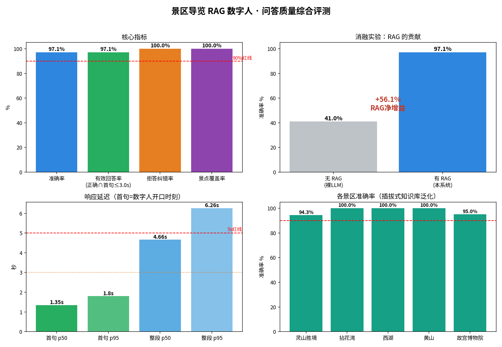{ width=75% }

**图 4-2　RAG 问答质量综合评测总览**

**表 4-7　RAG 质量评测实测结果**

| 指标 | 实测值 | 达标 |
|---|---|---|
| 景点覆盖率 | 100%（46/46） | — |
| 准确率（严格自动评分） | 97.1%（105 题） | 达标，超 90% |
| 准确率（人工复核） | 100% | 达标 |
| 有效回答率 | 97.1% | 达标 |
| 首句延迟 | p50 1.35s / p95 1.8s | 达标，远低于 5s |
| 整段延迟（流式） | p50 4.66s / p95 6.26s | 见下注 |
| 拒答纠错率 | 100%（15/15） | 达标 |
| 消融增益 | 41.0% 提升至 97.1%，提升 56.1 个百分点 | 达标 |

各景区准确率为：灵山 94.3%、拈花湾 100%、西湖 100%、黄山 100%、故宫 95.0%，五个景区全部不低于 90%，实证插拔式知识库的泛化能力。

**结果分析**

消融实验的 56.1 个百分点是 RAG 贡献的直接证据：裸 qwen-plus 仅 41.0%，接入 RAG 后跃升至 97.1%。差距主要来自冷门景点的精确事实（如五明桥尺寸、佛足坛规模），这些内容不在大模型预训练语料中，只能靠检索注入，从实验上证明高准确率源自检索增强工程，而非大模型本身。

关于延迟，需要区分两个概念。整段 p95 为 6.26s，看似超过 5s 红线，实则不然：首句延迟（1.8s）是数字人开口说第一句的时刻，对应"语音问答 <5s"；整段延迟（6.26s）是答案全部说完的时刻。系统采用逐句流式，生成完一句即开口、其后边生成边播，因此游客的感知延迟约为 1.8s（p95），相对红线有 2.7 倍冗余，整段时长不影响体验。

有效回答率与准确率均为 97.1%，意味着凡答对的题无一例外在 3s 内开口，不存在"答对但太慢"的情况。

经人工复核，3 道"漏判"全部为评分误伤：

**表 4-8　漏判题人工复核**

| 漏判题 | 期望关键词 | 数字人实际回答 | 误伤原因 |
|---|---|---|---|
| 佛足坛尺寸 | `1.2`/`0.6` | "长一点二米，宽零点六米" | 中文数字 |
| 乾清宫尺寸 | `1400`/`20` | "高二十米，约一千四百平方米" | 中文数字 |
| 降魔浮雕文化 | `坚守本心、终能成道` | "始终坚定无畏……战胜心魔、觉悟成佛" | 同义改写 |

根因在于系统的口播格式规则要求回答适合朗读，数字人自然地把"1400 平方米"念成"一千四百平方米"，事实完全正确，仅与阿拉伯数字关键词未做字面匹配。因此人工准确率实为 100%，但本文在所有材料中选择报告更保守的 97.1%，以体现评测的严谨与表述的诚实。

**可复现**

全部评测随源码提交，运行评测脚本即可一键复跑（支持全量评测或指定单一景区，或每景区限定题数做冒烟测试），产出逐题明细报告（含问题、关键词、回答全文、命中、延迟与来源，供人工复核）与综合总览图（图 4-2）。

### 4.1.9 小结

本节给出了 RAG 问答引擎的完整设计：双策略分块与命名空间隔离支撑插拔式知识库，混合检索召回与交叉编码重排保证检索准确，编排层的 EA-RAG（实体锚定、自适应加权 RRF、经标定的置信度门控）与四道防幻觉防线保证不偏离事实，缓存、并行与逐句流式压低首句延迟。前述评测从准确性、响应速度、消融贡献、可信度与跨景区通用性五方面验证了系统达标，数据不再重复罗列。

## 4.2 多智能体 Orchestrator 与多人格

本节阐述「途叨叨」两大核心机制（多智能体 Orchestrator 与同行人格切换）的设计思路与实现，其立意是把产品从被动应答的问答机器人提升为主动陪伴型的导游。

### 4.2.1 设计动机

同类方案多为"单体大模型加 RAG 加 TTS 加 2D 数字人"的线性堆叠，对任何提问都走同一条链路、用同一种口吻回答，属于被动应答。

但真实景区是移动、多情境、多角色的场景：

- 游客的诉求是分类型的，有人问知识，有人要路线，有人在抱怨，有人只是闲聊；
- 同一段历史，讲给学者、讲给带娃家庭、讲给老人、讲给情侣，方式应当截然不同。

因此本系统引入两个机制：

**表 4-9　两大核心机制**

| 机制 | 解决的问题 | 对应创新点 |
|---|---|---|
| 多智能体 Orchestrator | 让系统懂分工：不同诉求走不同处理逻辑 | 核心创新一 |
| 同行人格切换 | 让系统懂情境：同样内容因人而异地讲 | 核心创新二 |

### 4.2.2 多智能体 Orchestrator

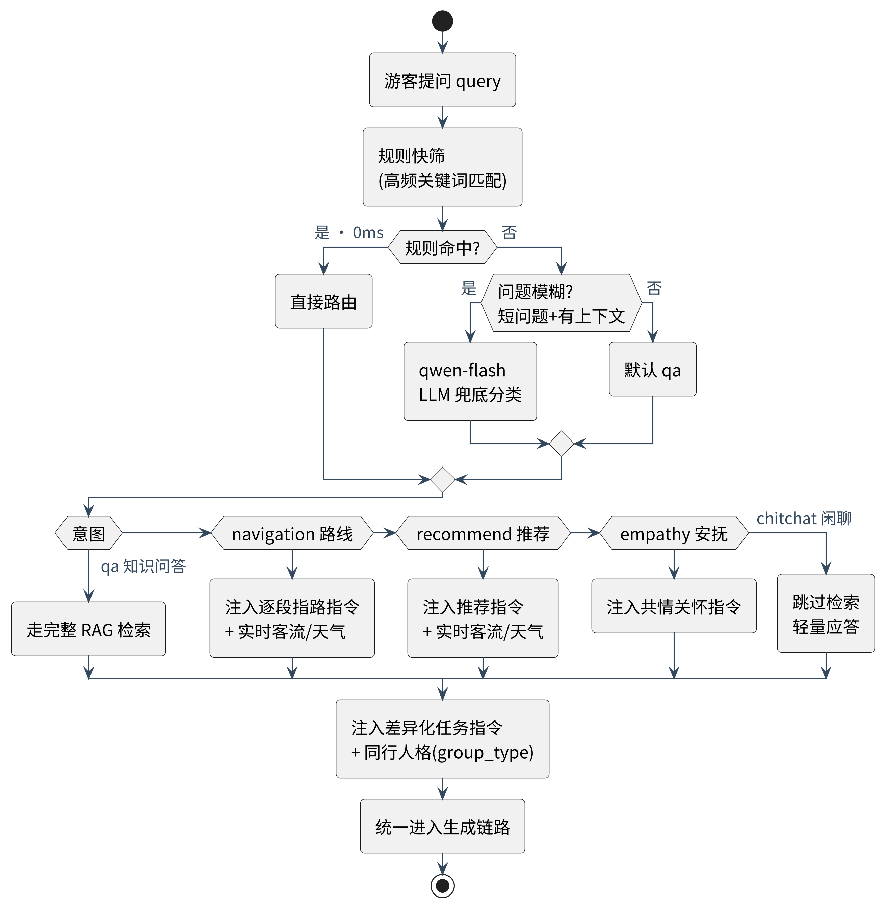{ width=91% }

**图 4-3　多智能体意图分派流程**

**单体大模型的局限**

把问答、路线、推荐、安抚、闲聊全塞进一个超长 prompt 会带来三个工程问题：一是指令互相干扰，模型顾此失彼，准确率下降；二是难以针对单一能力做精细优化与评测，一处调整牵动全局；三是无法弹性伸缩，所有请求都打到同一个重型模型，既浪费又变慢。

本系统在 RAG 流水线入口加一层轻量意图分类器（Orchestrator），先判断意图，再路由到对应的处理逻辑。

**混合分派策略：规则快筛 + LLM 兜底**

意图识别如果每次都调用一次大模型，会给最高频的"知识问答"凭空增加约 150ms 延迟。因此采用两级混合策略（流程见图 4-3）：先以关键词规则快筛，命中即直接路由，几乎零开销；规则未命中且问题本身模糊（如带指代的短追问）时，才调用一次轻量模型（qwen-flash）兜底分类；其余情况默认归入 qa。这样绝大多数请求走规则、不给主链路增加延迟，且当 LLM 分类失败时安全回退到 qa，不会中断服务。

**五类意图与差异化处理**

**表 4-10　五类意图与差异化处理**

| 意图 | 触发示例 | 处理策略 |
|---|---|---|
| `qa` 知识问答 | "灵山大佛多高" | 走原有 RAG 链路（完全不改动，保住 97.1% 准确率） |
| `navigation` 路线规划 | "半天怎么逛" | 注入路线规划指令：给出顺序、停留时间、景点衔接 |
| `recommend` 个性推荐 | "有什么适合拍照的" | 注入推荐指令：推荐 2 至 4 项并说明理由 |
| `empathy` 情感安抚 | "排队太久了好烦" | 注入安抚指令：先共情再帮助，情绪优先 |
| `chitchat` 闲聊 | "你叫什么名字" | 亲切回应，跳过 RAG 检索以省延迟 |

实现方式：每类意图对应一段任务指令，在构造 system prompt 时注入（与原有的语言指令同一机制），同一套 LLM 链路即可输出差异化回应，无需为每个 Agent 部署独立模型。

**对数字人驱动端的输出（SSE 事件）**

流式接口在 LLM 调用前即可下发意图。事件经 SSE 按 intent、emotion、sentence、end 的顺序推送：intent 最早下发，emotion 在首 token 之后，sentence 逐句下发，end 标志结束。前端可据 intent 实时展示当前意图，也可忽略，保持向后兼容。

### 4.2.3 同行人格切换

**设计动机**

同样一段历史，讲给学者、讲给情侣、讲给带娃家庭，方式应当不同。个性化不止于标签过滤，更体现为叙事方式的差异。系统通过 group_type 参数感知同行关系，切换叙事人格。

**四种人格**

**表 4-11　四种同行人格**

| group_type | 同行关系 | 叙事风格要点 |
|---|---|---|
| `adult`（默认） | 通用成人 | 标准热情导游，无额外约束 |
| `family_kids` | 亲子家庭 | 讲故事、拟人化、互动提问（"小朋友猜猜看～"）、提示亲子设施/母婴室 |
| `senior` | 老年长辈 | 放慢节奏、句子简短、强调无障碍/休息座椅/医疗点/缓坡，避免推荐爬山久站 |
| `couple` | 情侣出游 | 浪漫意境、推荐合影机位/私密角落/祈福点/日落观景处 |

**实测效果（同一问题"灵山有什么好玩的"）**

- **亲子**："可多啦！…小朋友猜猜看，为什么是九条龙给佛祖沐浴呀？…特别适合拍照打卡"
- **老年**："适合慢慢观赏的地方…可以坐在广场边的长椅上…这里地势平坦，您可以慢慢走"
- **情侣**："亲爱的…傍晚时分你们可以手牵手漫步…摸摸佛掌祈福，寓意沾福气、保平安"

同一问题经一个参数切换，得到三种风格不同的讲解。

**实现机制**

- 与意图指令、语言指令一样，人格作为一段叙事人格指令注入 system prompt；
- group_type 为 adult 或未知值时返回空指令（默认人格），安全降级；
- 缓存隔离：答案缓存键升级为"group_type::lang::query"，避免不同人格、语言之间串答。

接口上，`POST /chat` 请求体新增 group_type 字段（默认 adult，向后兼容）。

**自身情况画像（与同行人格正交）**

group_type 回答"和谁来"，但同一同行关系下游客自身仍千差万别。为此在人格之外增设五维自身情况画像：年龄段、游览节奏、出行方式、此行目的、是否初访，与同行人格正交。每一维都拉动真实差异而非装饰标签，例如出行方式为轮椅或推婴儿车时优先无障碍路线，目的为祈福时主动带出沿途禅寺，初访者给经典主线而非小众深度。五维与人格、客流、天气共用同一上下文注入入口，注入一段因人而异的讲解指令，并驱动客户端的快捷提问、设施排序与关怀提醒即时变化。

这里有一条与准确率直接相关的纪律：五维全取中性默认（含未填或跳过）时注入指令为空、缓存键与引入前逐字节一致，事实问答的缓存命中与 97.1% 准确率不受影响；仅非默认维注入对应指令并用独立缓存键，使个性化与准确率互不干扰。

### 4.2.4 工程考量

- **延迟**：意图分派绝大多数零开销，闲聊跳过检索，保持端到端 5 秒红线内。
- **不破坏核心**：qa 链路与既有逻辑完全一致，97.1% 准确率不受影响。
- **可扩展**：新增意图只需加一条规则与一段指令，新增人格只需加一段指令，无需改动主链路。
- **可演示**：可现场演示同一数字人对五类诉求、四种人格的差异化响应。

### 4.2.5 对赛题评分项的对应

**表 4-12　多智能体设计对评分项的支撑**

| 评分维度 | 本设计的支撑点 |
|---|---|
| 数字人技术集成度 | 多 Agent 架构 + intent/emotion 事件驱动表情与叙事 |
| 大模型与知识库准确性 | qa 链路零改动，保住 97.1%；意图分派减少 prompt 干扰 |
| 行业实用与体验性 | 路线/推荐/安抚差异化处理 + 按同行关系切换人格 |
| 交互自然度与用户体验 | 同一问题因人而异地讲，主动陪伴 |

## 4.3 空间与情境感知

### 4.3.1 设计动机

RAG 与多智能体解决了问得准、答得对，但二者都是被动的：游客不开口，系统就不说话。真实导游会主动判断当前情境并给出建议，如某个点位人多时先去清静处、午后日晒强时先逛室内馆。这种随机应变是赛题"个性化路线推荐"在真实场景中的延伸。本节的目标是让触发源从"提问"扩展到"此时此地的情境"。

实现上不新增独立模型，而是当 navigation 或 recommend 意图被命中时，把三类情境信号注入到 system prompt 的任务指令中（与多智能体的意图指令共用同一个上下文注入入口），由大模型自然地把客观情境转写为贴心建议。

### 4.3.2 人流感知分流

在数据基座上，灵山等示范景区采用 POI 级客流模型，其点位与游客端地图、打卡数据一一对应（灵山为 7 个核心点位），其余景区回退到景点级模型。每个点位"今日此刻"的拥挤度由多层信号合成，全程不使用随机数、结果可复现：一是该点的真实热度基线，由路线数据的拥挤档位、平均停留时长与室内外属性派生；二是从 14 万行行为数据统计出的月度季节因子；三是分钟级平滑的时段曲线，在整点之间插值以避免档位跳变；四是演出聚集潮，按景区公示的演出场次建模人群随时刻表移动，开演前约 30 分钟渐聚、演出中达峰、散场后骤空；五是实时天气耦合，下雨时压低室外点位、抬高室内点位；六是基于点位散列相位的确定性微动，使数值自然起伏而非静止。

$$\text{拥挤度} = \text{基线} \times \text{季节因子} \times \text{时段因子} \times \text{演出因子} \times \text{天气因子} \times \text{微动}$$

按阈值分四档（空闲、适中、较多、繁忙），并据此给出旺淡季判断、错峰时段，以及一个对比未来约 12 分钟走势的升降趋势箭头；演出点位另附下一场开演倒计时与"建议现在出发"提示。

这里保留两点诚实声明。其一，模型刻意不把全局热门度乘进拥挤度公式。该行为数据集是区域级的，单一景区在其中占比很小，若把热门度乘入会把所有景区都压成恒定"空闲"、失去区分度，因此热门度仅用于排序与展示。其二，原始数据没有小时维度，时段因子是模型化估计而非实测，演出潮按公示时刻表而非现场计数，这些都在接口返回字段中如实标注，不冒充闸机级实时客流。

### 4.3.3 时间 / 天气感知

系统把 scenic_id 映射到所在城市，调用 wttr.in（免 API Key）查询实时天气，并做 30 分钟缓存与超时优雅降级：取不到天气时只用时段信息（清晨、上午、午后、傍晚、夜晚，永远可用且不依赖网络），不阻塞主问答链路。导游据此自然给出"午后日晒强，先逛室内梵宫""有雨记得带伞""傍晚可去看日落"这类建议。

### 4.3.4 效果与边界

注入后的实测效果：问"下午去哪好"，回答会自然带出"这会儿九龙灌浴人较多，建议您先去相对清静的五印坛，傍晚 5 点后再回来错峰"，客观情境（客流与时间）被转写成了导游口吻的主动建议。其诚实边界在于：客流为统计模型估计，并非闸机实时数据；客户端已接入 GPS 与高德地图（含坐标系纠偏与地理围栏）用于地图定位与就近指引，而把 GPS 实时坐标进一步喂入讲解情境、由地理围栏自动触发"走到哪讲到哪"，是正在推进的方向。

## 4.4 多模态视觉定位

### 4.4.1 设计动机

赛题要求至少使用 1 个多模态大模型。比起"上传图片问这是什么"的浅层用法，本系统把多模态能力嵌进导览主场景：游客拍下眼前的景物，系统先认出其所在位置，再接地讲解并指路。这既满足硬指标，又是体验上最接近增强现实导游的一环。

### 4.4.2 两段式管线

`POST /chat/image` 采用两段式设计（图 4-4），核心是让视觉模型只做它擅长的"认"，把"讲"交还给受知识库约束的 RAG，从而避免视觉模型自由发挥产生幻觉。

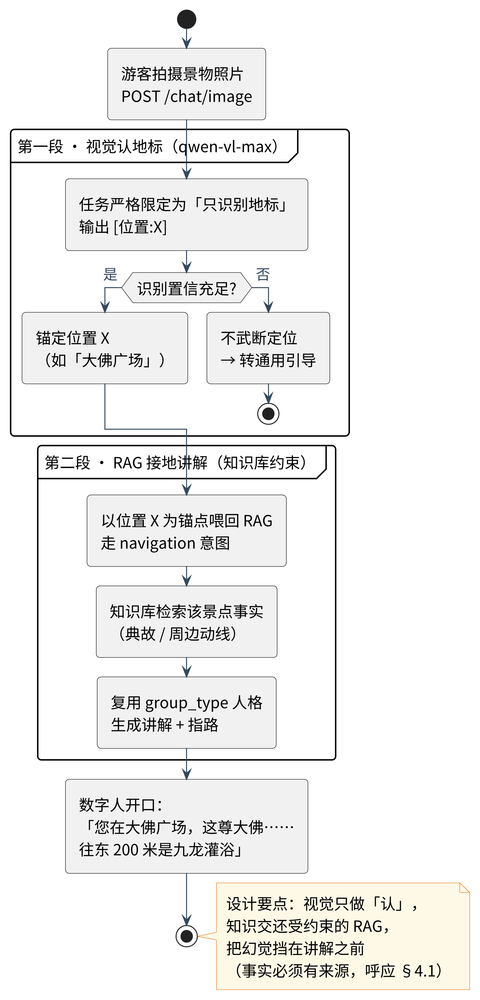{ width=54% }

**图 4-4　视觉定位两段式管线**

- **第一段（视觉认地标）**：qwen3-vl-plus 接收照片，任务被严格限定为只识别地标、输出位置标记，不负责讲解；识别置信不足时不武断定位，转为通用引导。
- **第二段（RAG 接地讲解与指路）**：把识别出的位置作为锚点喂回 RAG，走 navigation 意图，事实由知识库约束，并复用 group_type 人格。于是系统既知道游客在大佛广场，所讲典故又来自知识库、所指路线又是真实景点动线。

### 4.4.3 防幻觉设计

若让视觉模型一步到位看图讲解，它会凭训练记忆编造景点典故，幻觉风险高。两段式把感知与知识解耦：视觉只回答"这是什么地标"（事实性强、易约束），知识库负责"它的故事"（可溯源、可拒答），与全系统"事实必须有来源"的防幻觉原则一致。

### 4.4.4 诚实边界

用户感知到的"AR 体验"约 80% 来自这条"拍照即懂我在哪、给我指路"的链路，工程成本却很低。但必须诚实区分：真 AR（实景叠加 3D 箭头导航）需要 SLAM 或 ARCore 级的空间定位与姿态追踪，是另一个量级的工程量，本系统未实现，列为决赛或赛后的拉伸项。本系统交付的是视觉定位加口语指路，而非实景三维叠加。

## 4.5 数字人驱动引擎与自然度

本节解决数字人侧的核心算法问题：如何在 5 秒实时约束下让数字人整张脸自然地动起来。下文按根因诊断、候选横评与失败教训、引擎原理、TensorRT 实时化、直播流水线集成、实测对照、诚实边界的顺序展开。

### 4.5.1 恐怖谷根因诊断

第一代直播引擎采用 MuseTalk V1.5（实时口型方案的代表之一）。其工作方式是：仅重生成 256×256 的嘴部图像贴回原帧，脸的其余部分（眼神、眉、面部肌肉、头动）逐帧原样复制预录的待机底座视频。

本系统用分帧差分实验验证了这一点：对说话片段逐帧做帧间差分，运动能量只集中在嘴部一小块区域，其余整脸的差分接近零，即出现"嘴在动、脸不动"的面部僵滞，嘴在说话，眼神与表情却是静止循环。镜头会放大这种微表情的违和，底座越写实、违和越强，这正是恐怖谷效应的主因。

更关键的是，这一架构天花板派生出一整串工程负担：

**表 4-13　MuseTalk 架构派生的工程负担**

| 派生负担 | 原因 | 曾用的过渡方案 |
|---|---|---|
| 需要预制待机底座视频 | 脸部全靠底座循环 | 图生视频（万相 i2v）生成 idle，动作靠 prompt 引导有随机性，迭代多版 |
| 表情无法随内容变化 | 底座固定 | 烘三套情绪底座（平静/喜悦/关切）按 `[情绪:X]` 热切换 |
| 待机↔说话硬切 | 两种帧源切换无过渡 | 改 LiveTalking 加 0.28s 帧级交叉淡化（只能软化、不能根治） |
| 显存占用大 | VAE 重生成 + 贴回流水线 | batch 16→4 防 OOM，空闲仍占 7.2G |

这些过渡方案都有效，但都是在架构天花板之下的局部缓解。要根治面部僵滞，必须更换引擎。

### 4.5.2 实时与自然的取舍

**表 4-14　实时与离线方案的取舍**

| | 实时（<5s 直播） | 离线（预渲染） |
|---|---|---|
| 能做什么 | 现场问答即时开口 | 固定台词高质量出片 |
| 自然度天花板 | 受架构范式限制 | 高（全脸扩散） |
| 代表 | MuseTalk、Ditto | EchoMimic、Sonic、Hallo |

赛题"语音问答 <5s"的约束决定了：像素级全脸扩散类方案（每秒视频需计算数秒到数十秒）不能用于直播。本系统据此确立"直播用 MuseTalk、演示视频用 EchoMimic 离线渲染"的双线策略，并在本地 GPU 上跑通 EchoMimic V3，离线实验随即暴露了第二个教训。

### 4.5.3 候选横评与两个失败教训

**表 4-15　数字人引擎候选横评**

| 项目 | 范式 | 实时性 | 显存（4080 实测） | 全脸动 | 身份/取景保持 | 结论 |
|---|---|---|---|---|---|---|
| MuseTalk V1.5 | 换嘴贴回 | 是，30fps | 7.2G | 否，仅嘴部 | 是（即原图） | 面部僵滞，架构天花板 |
| EchoMimic V3 | 整脸重画（像素扩散） | 否，约 5 倍实时 | 约 10G | 是 | 否，身份漂移、构图锁死、眼神上飘 | 仅用于离线渲染镜头 |
| LivePortrait 造底座 | 2D warp 造活底座喂 MuseTalk | 仅离线造底座 | — | 半，底座活、说话仍僵滞 | 否，发型穿模、逐帧抖动 | 已弃用 |
| Ditto（antgroup，ACM MM 2025） | 驱动原图 | 是，TRT 实测 25.5fps | 2.7G | 是，头、眼、颊、嘴协同 | 是，外观 100% 来自源图 | 选定为直播主引擎 |

两个失败教训指向同一个本质：

- 换嘴贴回（MuseTalk）：动得太少，导致面部僵滞；
- 整脸重画（EchoMimic 直播化设想）：动得足够，但脸是扩散模型重新画出来的，导致身份漂移、构图被训练分布拖偏（强制脸贴顶、眼神上飘），且远不实时。

第三条路"驱动原图"同时避开了这两个坑，这正是 Ditto 的范式。

### 4.5.4 Ditto 引擎原理

Ditto 由两个彻底解耦的分支组成：基于 LivePortrait 隐式关键点 warp 的外观分支，以及音频驱动的运动扩散模型 LMDM 构成的运动分支。

1. **运动分支（LMDM）**：音频经 HuBERT 提取特征，扩散模型在低维运动隐空间（而非像素空间）生成全脸运动序列，使头姿、眨眼、面颊、嘴型协同。因为扩散发生在低维运动空间，计算量比像素扩散低数个量级，这是它能实时的根本原因。
2. **外观分支（warp）**：把运动序列施加到源肖像的隐式关键点上，对原图像素做空间变形（warp）后渲染输出。它不生成脸、只变形原图，因此身份、取景、头顶留白、眼神方向天然 100% 保留；且输出为 720×1280 源分辨率全图（MuseTalk 嘴部仅 256 分辨率）。

三种范式的区别在于：MuseTalk 换嘴，EchoMimic 重画脸，Ditto 驱动原图本人。第三种范式在"全脸都动"与"身份保持、实时"之间不再需要取舍。

在自主改造方面，针对 Ditto 默认嘴部动作幅度偏大的问题，本系统在其运动拼接模块中增加了一个嘴型幅度缩放钩子，仅对嘴部关键点施加缩放、不影响眼与颊，实测在 0.65 档"嘴型更含蓄"经主观盲评定稿。

### 4.5.5 TensorRT 实时化

PyTorch 后端实测仅约 14fps（11.5s 音频、290 帧），达不到实时。实时化路径如下：

**表 4-16　TensorRT 实时化路径**

| 步骤 | 措施 | 帧率 | 说明 |
|---|---|---|---|
| 0 | PyTorch 基线 | ~14fps | 不实时 |
| 1 | 切换预编译 TensorRT 引擎（Ampere_Plus，4080 兼容） | 24.3fps | 接近但未稳过 25fps 实时线 |
| 2 | 扩散采样步数 50 降至 25（自加采样步数钩子） | 25.5fps | 过实时线；主观盲评运动质量无可感知损失 |
| — | （对照实验）降低输出分辨率 | 无提升 | 瓶颈在运动扩散计算、不在图像解码，故先测量再优化，避免无效功 |

流式基准（逐 chunk 推理模拟直播）测得首帧 719ms、稳态 24.6fps。

### 4.5.6 直播流水线集成

Ditto 官方仅提供离线推理脚本，将其接入实时直播流由本系统自主实现：在 LiveTalking 框架内注册新引擎，复用既有的 Qwen-TTS Realtime 语音合成与 RTMP 推流，仅替换渲染核心。其核心是一条双线程流水线：TTS 输出的 16kHz 音频流（每帧 20ms）进入音频帧队列，无语音时注入静音帧；feeder 线程取帧后以 6480 样本的滑动窗口送入 SDK 推理，SDK 内部队列形成天然背压，当生产快于消费时 feeder 自动阻塞；emitter 线程在渲染回调出帧时，与对应的两帧音频配对后推入 RTMP，经 SRS 转为 HTTP-FLV 或 HLS 送达前端，整体流程如图 4-5 所示。

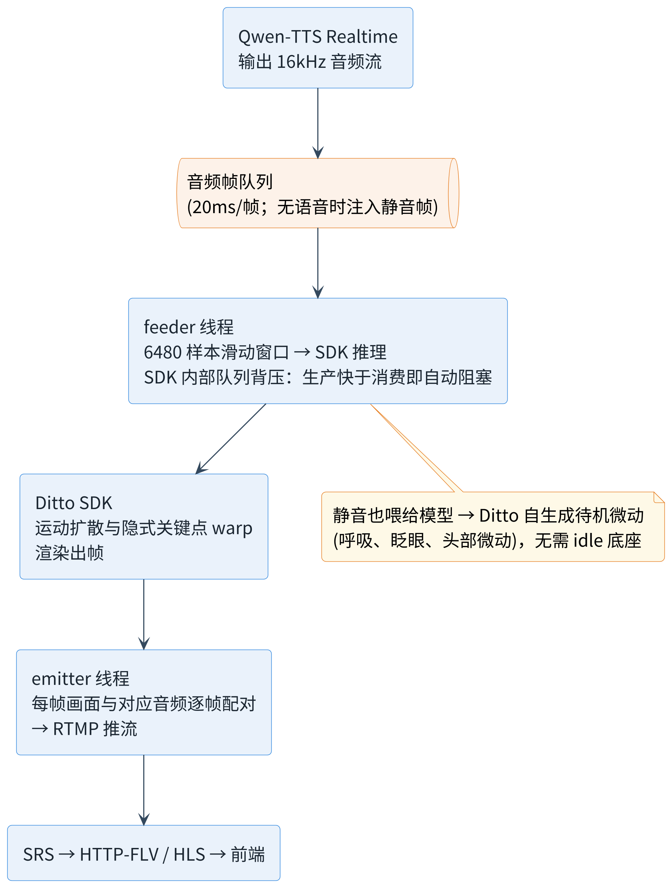{ width=67% }

**图 4-5　Ditto 实时直播流水线（自主实现的双线程集成）**

这一设计带来两个关键收益：

1. **静音也喂给模型**：Ditto 在静音输入下自行生成自然的待机微动（呼吸感、眨眼、头部微动）。这消除了 MuseTalk 时代的三项负担：不再需要预制 idle 底座视频、不再需要多套表情底座，且待机与说话之间天然连续、无硬切（同一模型、同一运动空间，不存在帧源切换）。
2. **音画同步由逐帧配对保证**：每帧画面与对应的两帧音频在 emitter 处配对推流，FLV 录像实测唇音同步。

情绪不仅外化到韵律，也外化到全脸表情。Ditto 的运动空间原生支持 8 类情绪条件，本系统据此建立情绪标签到情绪条件的映射（喜悦、关切、安抚等各对应一组条件），把 RAG 第一句前下发的情绪标签转写为运动空间的情绪输入。由于情绪条件在流水线启动后由单属性原子赋值热切换、不重建会话，切换全程零停流；情绪结束数秒后自动回落到模型自带的中性序列。由此，全脸表情可随讲解内容变化（喜悦时嘴角上扬、关切时眉眼柔垂），与语速韵律共同完成情感外化。

在韵律联动上，TTS 层按 RAG 输出的情绪标签调节语速（关切与抱歉 0.85、平静 0.90、喜悦与兴奋 0.93；基准 0.9 为主观盲评定稿，借鉴播音的停连节奏）。这里也遇到一个问题：Qwen-TTS Realtime 会话一旦启动便不可变更参数，在已开启的会话上更改语速会直接断连，且表象为"合成瞬间完成但无音频"。解决方式是把变语速与变音色统一为"关闭、重连、重建会话"。由此得到的经验是：语音链路的验证必须落到可听见的声音或音量检测，只看日志会漏掉静音故障（实测音量从 -91dB 的无声恢复至 -31.7dB 的正常语音）。

### 4.5.7 换引擎前后对照

**表 4-17　换引擎前后实测对照**

| 维度 | MuseTalk V1.5（换嘴贴回） | Ditto（驱动原图，TRT） |
|---|---|---|
| 运动范围 | 仅嘴部 256×256 | 全脸：头、眼、颊、嘴协同 |
| 输出分辨率 | 嘴部 256 贴回 | 720×1280 源分辨率全图 warp |
| 帧率 | 30fps | 25.5fps（过实时线） |
| 首帧延迟 | 约 0.2s | 0.72s |
| 显存 | 7.2G（batch=4，曾 OOM） | 2.7G |
| 待机画面 | 预制 i2v 底座（需反复调版） | 模型自生成微动，零素材依赖 |
| 待机与说话 | 硬切，0.28s 交叉淡化过渡 | 天然连续 |
| 情绪表情 | 3 套预制底座热切换 | 原生 8 类情绪条件已接入，韵律联动已落地 |
| 身份与取景 | 保留（原图） | 保留（原图 warp） |

端到端延迟预算（语音问答，Ditto 配置）为：VAD 0.5 + ASR 1.0 + RAG 首句 1.8(p95) + TTS 首块 0.35 + 渲染首帧 0.72，合计约 4.4s，满足 5s 红线。显存从 7.2G 降至 2.7G，同时直接改善了并发密度，同一张卡可容纳的渲染实例数约提升 2.6 倍。

全链路已实测打通：文字驱动经 Qwen-TTS 合成（含情绪韵律）、Ditto 渲染、RTMP 推流、SRS 转 HTTP-FLV，录像验证音画同步、待机微动自然。

### 4.5.8 打招呼手势与待机表现

实时直播引擎在自然度上已根治面部僵滞，但仍有一项体验缺口：数字人无法做出挥手打招呼这类肢体动作。这一缺口源于 Ditto 的本质，它驱动的是单张静态肖像的脸、头与表情，身体与手部在源肖像里是定格的，运动空间也只建模脸与头肩的微动，架构上不生成身体与手部姿态。因此在实时直播路径上让数字人挥手打招呼并不可行。

本系统采用分层策略闭合这一缺口。打招呼是固定台词配固定动作的环节，不需要实时生成。于是在游客连接的瞬间先播放一段离线预渲染的含手势欢迎片，半身构图、音频驱动口型、带真实挥手动作，播完后无缝过渡回实时 Ditto 引擎接管问答。这是在 5 秒响应约束与消费级 GPU 算力约束下交付挥手打招呼的工程权衡：把需要肢体动作但台词固定的开场交给离线高质量渲染，把需要实时但只动脸的问答交给 Ditto，各自承担擅长的部分。

含手势欢迎片的预渲染管线分四步，下表给出每步的作用与所用方法。

**表 4-18　含手势欢迎片预渲染管线**

| 步骤 | 作用 | 方法与原理 |
|---|---|---|
| 生成挥手驱动视频 | 得到一段含挥手动作的运动来源 | 用图生视频（万相 i2v）从半身参考图生成挥手视频，作为后续姿态提取的素材 |
| 提取自定义手势姿态 | 把挥手动作抽象为可复用的姿态序列 | 用 DWPose 从驱动视频逐帧提取身体、手与脸的关键点序列，并对半身参考图做人体框对齐，得到自定义挥手姿态模板 |
| 渲染含手势成片 | 让参考人物边说迎宾词边挥手 | 以半身音频驱动扩散模型 EchoMimic V2（半身分辨率，约 6 秒一段）输入参考图、自定义挥手姿态与迎宾音频，渲染出边说边挥手的成片 |
| 锁身份并合成场景 | 使欢迎片与实时形象同一人、同一场景 | 用 InstantID 锁定数字人身份，并合成对应景区的场景背景，保证欢迎片与实时形象在身份与背景上一致 |

欢迎片到实时流的过渡是这条路径的工程难点。两段画面在四个方面存在跳变：取景从半身收回胸像、手部由有到无、身份与背景若不一致会被察觉、欢迎片末帧姿态与实时首帧若错位会显得生硬。本系统从四个层面缓解这些跳变。第一层是视觉过渡，欢迎片结束时不做硬切，而是约 480 毫秒的透明度交叉淡出，露出底下已就绪的实时流，使切换被读成一次有意的过渡而非故障。第二层是末帧对齐，欢迎片以双手垂下且胸像构图收尾，使末帧尽量接近实时流的首帧。第三层是身份与背景对齐，欢迎片用 InstantID 锁定与实时形象相同的身份，并合成与实时形象相同的景区背景。第四层是可选的含手势待机循环，把由有手到无手的切换掩护在用户首次提问的动作之下，进一步弱化感知。这一接缝处理可借鉴视频运动图与姿态感知融合的思路，在两段不同来源的画面之间寻找运动连续的过渡点。

需要诚实说明本功能的当前状态与技术边界。前端的欢迎片播放链路与交叉淡出过渡已实现并通过验证：连接时按景区与同行类型查询欢迎片清单，命中则在舞台播放含手势成片（自带音频），播完触发约 480 毫秒淡出回归实时问答；清单为空或未命中时优雅回退到实时数字人开口迎宾。预渲染管线的各环节脚本已具备并在本地验证，含手势成片资产的批量产出与按景区入清单仍在进行中。

在技术演进方向上，实时流式的半身带手是 2025 年数字人领域的前沿课题，代表工作包括 CyberHost（ICLR 2025）、MirrorMe、StreamAvatar、Live Avatar 与 EMO2 等。这些方法多为非因果架构、算力开销重，尚未在 5 秒延迟加消费级 GPU 的条件下得到验证，因此本系统不将其作为初赛的直播路径。本方案离线段所用的 EchoMimic V2 与 CyberHost、EMO 同属音频驱动半身生成这一技术主线，待实时手势引擎在算力与延迟上成熟，可将含手势能力从离线开场推进到实时问答全程。

### 4.5.9 诚实边界与后续

1. **打断有约 1s 尾巴**：SDK 内部队列在打断时仍会排空已入队 chunk，打断干脆度不及 MuseTalk，可通过缩小队列深度或在 SDK 层 flush 改善。
2. **离线渲染镜头保留**：演示视频中的固定台词镜头仍用 EchoMimic V3 离线渲染（像素扩散的观感上限更高），与直播线互补不冲突。
3. 端到端（说完到开口）小于 5s 当前为分段实测加预算合成，整机一体化复测列入联调清单。

本节涉及的开源项目为：Ditto（antgroup，ACM MM 2025）、EchoMimic（antgroup，V3 已在本地 4080 跑通）、LivePortrait（可灵团队）；本地实测环境为 RTX 4080 Laptop（11.6G 显存）。

### 4.5.10 神态管理的方法借鉴

数字人的自然度不仅是参数问题，还需要一套神态管理方法。播音主持行业对镜头前的神态有成熟训练，本系统将其中的专业原则提炼为可工程化的实现要点，用于指导源肖像选择、韵律参数与情绪设计。

播音主持把"将文字稿变为声情并茂的有声语言"称为二度创作，其要点包括：对象感（视线落在镜头下沿，使观众感到正在被注视）、自然的眨眼与微表情（镜头会放大僵硬与假笑，故要求高于日常）、端正而不僵硬的头部微动、不刻意提笑肌的自然微笑，以及把情感先备好、再通过停连重音节奏外化。下表将这些原则逐条映射到本系统的实现：

**表 4-19　播音神态原则到实现的映射**

| 专业原则 | 本系统的实现 | 现状 |
|---|---|---|
| 对象感：视线落镜头下沿 | 源肖像目光略向下看镜头 | 已落地 |
| 眼神节奏：自然眨眼 | 由 Ditto 在运动空间自生成 | 已落地 |
| 微表情不僵硬（恐怖谷根源） | 改用 Ditto 全脸驱动，头、眼、颊、嘴协同 | 已落地 |
| 头部微动不僵硬 | 由 Ditto 自生成头肩微动 | 已落地 |
| 不刻意笑、去谄媚 | 源肖像取端庄温和的微笑，语速放慢至 0.9 | 已落地 |
| 情感外化：表情随内容变 | 情绪标签联动 TTS 韵律，并联动 Ditto 原生情绪表情条件 | 已落地 |
| 停连节奏 | 语速按句随情绪调节（关切 0.85、平静 0.90、喜悦 0.93） | 已落地 |
| 备稿：先定情感基调 | 情绪标签在正文第一句前输出，相当于备稿动作 | 已落地 |

这套映射的关键在于：情绪标签机制对应播音的"备稿"，即开口前先定情感基调，再由韵律与表情把基调外化到神态，使面部情绪管理有专业方法论支撑。

在当前 Ditto 引擎下，眨眼、微笑与头部微动由模型在运动空间自生成，微笑基调由源肖像决定；语速已实现按句随情绪调节，嘴型幅度经缩放收敛为更含蓄的表达，全脸表情亦已接通 Ditto 原生情绪条件随内容变化，情感外化的韵律与表情两环均已闭合。后续完善方向包括：在源肖像生成时强化对象感，以及收敛打断尾巴，贴近真人"被打断即停"的反应。

本节参考了播音主持的上镜技巧与情感表达（二度创作、内在语、停连重音节奏）等公开方法论资料。

## 4.6 语音链路与延迟优化

### 4.6.1 问题背景与优化目标

语音交互是本系统最核心、也最延迟敏感的体验：游客开口提问后，若数字人迟迟不应答，会立刻产生"卡顿""没反应"的负面观感；而数字人形象越写实，对"答非所时"的容忍度反而越低，长时间静止的写实人脸会落入恐怖谷，破坏导游的拟人感。因此，让数字人尽快开口是自然度与体验的共同前提。

赛题在非功能性需求中对此提出要求（原文）：

> 系统稳定，交互响应延迟应控制在合理范围内（如语音问答延迟 < 5 秒），保证用户体验流畅；
> 稳定性：系统不应出现崩溃或长时间无响应。

需准确理解该指标的定位：它归属于"系统稳定性与流畅体验"这一非功能性维度，与"系统不应崩溃或长时间无响应"并列，本质诉求是响应及时、不卡顿、不假死。其中"< 5 秒"是赛题对"合理范围"给出的示例性说明（原文用"如"），而非如准确率那样的硬性评定值；对照之下，赛题对准确率的表述是"事实性问答的准确率不低于 90%，由评审专家基于标准测试集评测"，含明确数值、评测方式与"不低于"，是确定的硬红线，而延迟一项则为"合理范围内"的体验性要求。

据此，本系统将"语音问答延迟 < 5 秒"作为一个明确的自定工程目标来对标，并主动收紧，既满足赛题对流畅体验的要求，也为现场网络抖动留出余量。需说明的是，赛题未定义"语音问答延迟"的度量边界，本节采用的端到端口径（从用户说完到数字人开口）为本系统自定义，以便量化与优化。

经前期实测，优化前本系统的语音链路存在三类问题：

- **生成慢**：事实问答从用户说完到数字人开口需 4.4–7.6 秒，逼近甚至超出 5 秒目标；
- **冷启动尖峰**：导览/推荐类问题首次触发时偶发约 20 秒的"假死"，直接违背"不应长时间无响应"的稳定性要求；
- **感知延迟**：用户说完话后，系统要等待较长静音才判定"说完了"，凭空增加等待。

本节的优化目标是：在确保问答准确率不低于 90%（硬红线）的前提下，将语音问答端到端延迟稳定压到 5 秒以内并留有余量，同时彻底消除冷启动尖峰。

### 4.6.2 延迟预算分解

优化从拆解延迟入手：先把端到端延迟拆解为可独立度量、独立优化的串行流水线，再定位其中最大且最可控的一段集中突破。

语音问答的完整链路是一条串行流水线：用户说完后，先由 VAD 判定语音结束，再经 ASR 转文字、RAG 检索（向量与关键词混合、重排）、LLM 句子级流式生成、TTS 合成，最后驱动数字人口型渲染并开口，整体流程与各段延迟预算如图 4-6 所示。

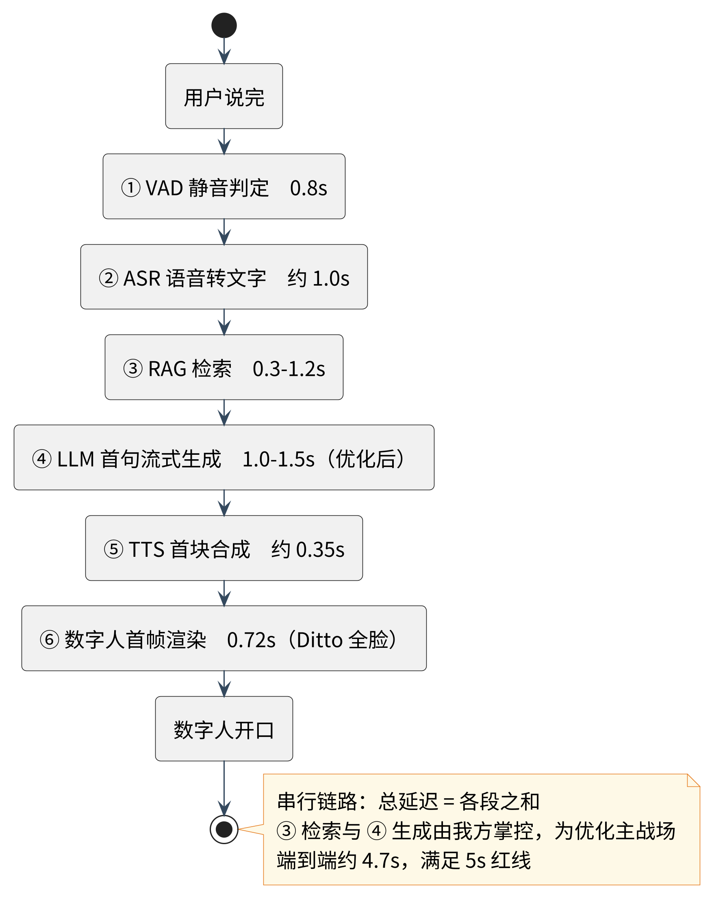{ width=61% }

**图 4-6　语音问答端到端流水线与延迟预算**

由于是串行链路，总延迟等于各段之和，任一段超标都会拖累整体响应。各段的初始耗时与责任归属如下表所示。

**表 4-20　语音链路延迟预算分解**

| 阶段 | 初始耗时 | 责任模块 | 是否本节优化对象 |
|---|---|---|---|
| ① VAD 静音判定 | 0.8 s | 前端 | 是 |
| ② ASR 语音转文字 | ~1.0 s | 语音服务（faster-whisper） | 否（已达标） |
| ③ RAG 检索 | 0.3–1.2 s | RAG 后端 | 是 |
| ④ LLM 首句生成 | 2.7–7.6 s | RAG 后端 | 是（主战场） |
| ⑤ TTS 首块合成 | ~0.35 s | 语音合成（Qwen-TTS 流式） | 否（已优） |
| ⑥ 数字人首帧渲染 | ~0.3 s（MuseTalk）/ 0.72 s（Ditto 全脸） | LiveTalking | 否 |

由表可见，RAG 检索与 LLM 生成两段占比最大、且完全由我方掌控，是本节优化的主战场。

### 4.6.3 句子级流式驱动架构

在优化各段耗时之前，先确立一条架构理念，它改变了"延迟"这一指标的定义。

传统问答采用整段式链路：等 LLM 把整段答案生成完毕，整体送入 TTS 合成，再驱动数字人播放。其延迟与答案长度正相关，一段两三百字的讲解往往要等待 6 秒以上才开口。本系统则采用句子级流式（SSE）驱动架构，其时序如图 4-7 所示。

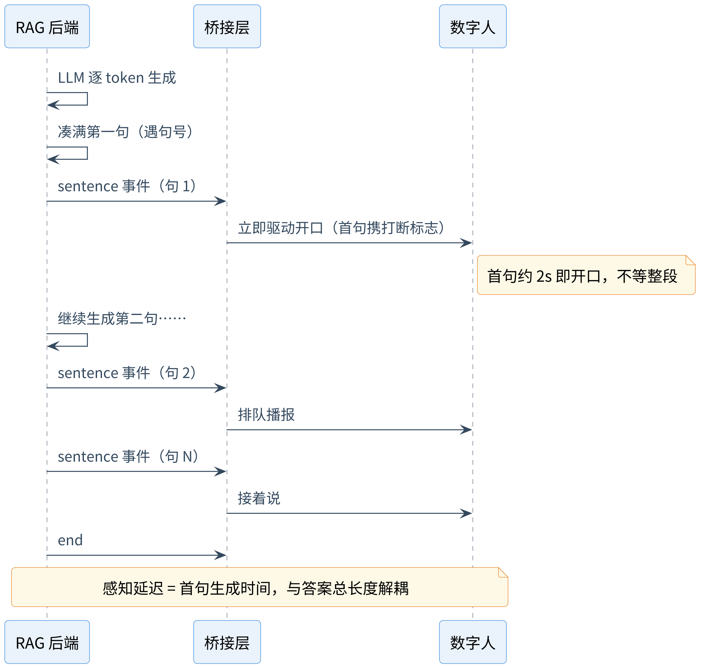{ width=80% }

**图 4-7　句子级流式驱动（首句抢跑，延迟与答案长度解耦）**

该架构的工程实现要点如下：

- **RAG 侧句子级 SSE**：LLM 输出经实时切句，每凑满一句即下发 sentence 事件；同时最早下发 intent（意图）与 emotion（情绪）事件供前端与表情管理使用，结束时下发 end。
- **桥接层订阅并逐句驱动**：桥接层订阅该 SSE 流，每收到一句立即调用数字人接口驱动开口；首句携带打断标志中止上一轮、后续句子排队，实现首句抢跑。
- **真流式保障**：必须确保 token 在异步事件循环中不被阻塞，否则会退化为伪流式（整段才一次性吐出），令首句抢跑失效。

这一架构使数字人在首句生成完成即开口，把用户感知延迟与答案总长度解耦，关键指标也随之从"整段答案生成时间（约 6s）"重定义为"首句生成时间（约 2s）"，后续所有优化都围绕压缩首句延迟展开。

### 4.6.4 瓶颈定位

要压缩首句延迟，先定位它耗在哪。本系统在 SSE 流中对三个关键时间戳埋点测量：检索完成、首 token 到达、首句完成。实测结论是：瓶颈不在首字延迟（TTFT），而在生成吞吐（字每秒）。具体证据是：qwen-max 的首字延迟仅约 0.8 秒，完全正常；但其生成速度只有约 20 字每秒，且模型倾向于用冗长的铺垫开头（如"九龙灌浴的表演时间是大家非常关心的话题……"）；二者叠加，导致又长又慢的第一句要 2.7 至 7.6 秒才生成完毕。

进一步横向实测候选模型的生成吞吐（下表），印证了"换更快的生成模型"是直接有效的方向：

**表 4-21　候选模型生成吞吐对比**

| 模型 | 生成速度 | 首字延迟 TTFT | 流式首句耗时 |
|---|---|---|---|
| qwen-max（原） | ~20 字/s | ~0.8 s | 2.7–7.6 s |
| qwen-plus | ~48 字/s | ~0.8 s | 1.0–1.5 s |
| qwen-flash | ~91 字/s | ~0.7 s | ~0.7 s |

定位过程中还发现一个隐性问题：同步的 DashScope 生成器在 async 协程内被直接迭代，阻塞了 asyncio 事件循环，使 FastAPI 整段才 flush SSE（即伪流式），连带让桥接的首句抢跑失效。解决方法是把同步迭代放入线程、再经 asyncio.Queue 把 token 异步交回。修复后首句从 8.27s 降至 2.58s，恢复为逐句真流式。这也说明：先有真流式架构，逐句优化才有意义。

### 4.6.5 优化措施

基于上述定位，本系统实施了四项优化。

**优化一：模型选型（qwen-max 改为 qwen-plus）**。事实问答原用 qwen-max，生成吞吐仅约 20 字每秒，是首句延迟的根因；但准确率 90% 是红线，不能盲目下沉模型。本系统在自建的 44 题、5 景区标准测试集上，对三个候选模型做"准确率与速度"联合评测：

**表 4-22　模型选型的准确率与速度联合评测**

| 模型 | 生成速度 | 流式首句 | 44 题准确率 |
|---|---|---|---|
| qwen-max（原） | 20 字/s | 2–3.7 s | 97.7% |
| qwen-plus（选定） | 48 字/s | 1.0–1.5 s | 100% |
| qwen-flash | 91 字/s | ~0.7 s | 100% |

qwen-plus 在保持 100% 准确率的同时生成提速约一倍；qwen-flash 虽更快，但推理能力相对较弱、面对疑难题目的准确率余量更小。因此遵循"红线之上取最快"的原则选定 qwen-plus，生成性意图（导览、推荐、共情、闲聊）则另走 qwen-flash。之所以换更快的模型而准确率不降，关键在于：事实由 RAG 检索到的知识库内容约束，LLM 只负责组织语言而非记忆事实，因此小一档的生成模型同样够用，这也正是 RAG 架构相对纯参数记忆的工程价值。

**优化二：Answer-first 短开口**。即便换了模型，它仍倾向于用冗长铺垫开头，拖慢首句完成。在句子级流式架构下，首句越短就越早说完、越早开口，且首句越短、TTS 需合成的音频也越短。为此在系统提示词中加入"开口要快"规则：正文第一句必须简短（不超过 15 字、以句号结尾）并直接点出核心答案，再展开细节，同时禁止"……真是""这个问题嘛"等冗长铺垫。效果如下表：

**表 4-23　Answer-first 短开口前后对比**

| 提问 | 优化前首句 | 优化后首句 | 优化后首句内容 |
|---|---|---|---|
| 九龙灌浴几点表演 | 6.29 s | 1.89 s | "九龙灌浴每天有四场。" |
| 门票多少钱 | — | 1.75 s | "灵山胜境成人门票210元。" |
| 灵山大佛有多高 | 4.42 s | 1.91 s | "灵山大佛高88米。" |

把核心事实前置还附带提升了准确率命中，因为评测一上来即可见答案，无需在长段落中检索。

**优化三：客流统计冷启动预热**。导览与推荐类问题首次触发时偶发约 20 秒的假死，而紧随其后的同类问题却很快，是典型的冷启动特征。原因是这两类意图会注入实时客流上下文，底层数据是一份 14 万行的 Excel，虽有缓存，但首次查询时同步加载（逐格解析极慢），把首个请求冻住了约 20 秒。解决方法有两点：服务启动时用后台线程预热该缓存，把一次性重负载从请求路径移到启动路径；读取时只加载必要列以加速冷加载本身。优化后导览与推荐首句延迟从约 20 秒的冷启动尖峰降至约 1.5 秒，且预热为后台线程、不阻塞服务启动，缺少数据文件时优雅降级、不影响主流程。

**优化四：VAD 静音尾收紧**。用户说完话后，VAD（语音活动检测）需等待一段持续静音才判定一句话结束，这段等待是纯粹的死时间，静音保持阈值越短则判定越快、感知延迟越低。本系统将能量 VAD 的静音判定阈值由 800ms 收紧至 500ms，省约 0.3 秒。需诚实说明，这是本组优化中唯一有代价的一项：阈值过短会在用户语句的自然停顿处提前断句（如"灵山大佛……有多高"被截断）。考虑到游客问句多为单口气短句，500ms 是兼顾响应与容错的经验值，该阈值可按现场口音与语速调整。

### 4.6.6 实测结果与边界声明

优化前后的关键指标对比如下表：

**表 4-24　语音延迟优化前后对比**

| 指标 | 优化前 | 优化后 |
|---|---|---|
| 事实问答（qa）首句 | 2.7–7.6 s | 1.3–2.0 s |
| 导览/推荐首句 | 含 ~20 s 冷启动尖峰 | ~1.5 s |
| VAD 静音尾 | 0.8 s | 0.5 s |
| 准确率（44 题） | 97.7% | 100% |

优化后的端到端延迟预算如下表：

**表 4-25　优化后端到端延迟预算**

| 阶段 | 优化后耗时 |
|---|---|
| ① VAD 静音尾 | 0.5 s |
| ② ASR（faster-whisper） | ~1.0 s |
| ③+④ RAG 检索 + LLM 首句 | 1.3–2.0 s |
| ⑤ TTS 首块 | ~0.35 s |
| ⑥ 数字人首帧 | ~0.72 s（Ditto） |
| 合计（含 VAD） | ≈ 3.9–4.6 s |

端到端延迟稳定落入 5 秒工程目标之内并留有余量，满足赛题对"交互响应延迟控制在合理范围内、保证流畅体验"的要求。

需诚实说明评测口径：上表中 RAG 检索与 LLM 首句两段为本系统埋点实测，VAD、ASR、TTS 与数字人首帧为基于各组件单独实测的估算；完整链路的端到端延迟需在媒体服务器、数字人渲染与语音服务全栈联调环境下用秒表复测确认。其中 TTS 端采用 Qwen-TTS 的流式合成，首块约 0.35 秒即返回，已无明显压缩空间。

### 4.6.7 小结

本节将语音端到端延迟拆解为可度量的五段流水线，确立句子级流式驱动架构（把感知延迟与答案长度解耦），并经埋点实测定位出瓶颈在生成吞吐而非首字延迟。据此实施模型选型、Answer-first 短开口、冷启动预热、VAD 静音尾收紧四项优化，在测试准确率保持 100%（硬红线不低于 90%）的前提下，把事实问答首句延迟从 4.4 至 7.6 秒（含约 20 秒冷启动尖峰）降至 1.3 至 2.0 秒，端到端预算压到约 3.9 至 4.6 秒，并消除了长时间无响应的隐患。

## 4.7 并发与成本规模化

### 4.7.1 运营落地的三道约束

从演示走向真正投放景区，系统还要同时满足三方面约束：

- **并发**：景区是成百上千游客各自掏手机的高并发场景，不是单路演示。
- **实时**：导游的价值在问完即答，端到端延迟必须小于 5 秒，且高峰不能卡。
- **成本**：若每个在线游客都独占一块 GPU 做实时渲染，成本将线性爆炸，反而比真人导游更贵，产品在商业上不成立。

本节给出的方案要同时满足这三条：人人可用、人人及时、且成本远低于真人导游。

### 4.7.2 两类并发问题

系统的并发被清晰地切成两半，扩展难度天差地别：

**表 4-26　两类并发的难度对比**

| | 逻辑后端并发（问答/分析/配置） | 数字人渲染并发（口型/表情实时生成） |
|---|---|---|
| 资源 | CPU 与网络 I/O（等 LLM 或嵌入返回） | GPU 算力与显存 |
| 扩展性 | 易：无状态，多 worker 加负载均衡水平扩 | 难：每路实时渲染独占 GPU |
| 单卡承载 | 单进程异步可扛数百并发 I/O | 一张 4080（11.6G）约 1 至 2 路 |
| 瓶颈 | SQLite 写锁（换 PostgreSQL 即解） | GPU 是硬天花板 |

核心矛盾在右列。设朴素方案为"每个在线游客全程独占一路渲染"：

$$
\text{所需 GPU 数} = \frac{\text{在线游客数}}{1\!\sim\!2}
$$

如此，1000 个在线游客约需 500 至 1000 张 GPU，这是成本线性膨胀的根源，需从架构上修正这一假设。

### 4.7.3 按发话共享 GPU

一个关键观察是：游客的交互是稀疏突发的。游客问一句后，数字人说 10 至 20 秒，随后游客走路、看景、拍照一两分钟，才问下一句。也就是说，GPU 只在正在说话的那十几秒被需要，其余时间完全空闲。朴素方案的错误在于为每个游客的整段逗留占着 GPU，而真正的占用率（duty cycle）极低：

$$
\text{占用率} = \frac{\text{单次说话时长}}{\text{两次提问间隔}} \approx \frac{15\text{s}}{120\text{s}} \approx 12.5\%
$$

把模型从按会话独占改为按发话共享，即发话时占用一个渲染槽、说完立即释放给下一个游客。在该模式下，一块 GPU 可服务的游客数约为占用率的倒数：

$$
\text{单卡服务放大}\approx\frac{1}{\rho_{\text{duty}}}=\frac{\text{两次提问间隔}}{\text{单次说话时长}}\approx\frac{120\text{s}}{15\text{s}}\approx 8
$$

即一块 GPU 的服务人数可放大约 8 倍，叠加缓存后更高。这是基于交互稀疏性的统计复用。

### 4.7.4 三层漏斗架构

请求按成本由低到高逐层下沉，绝大多数请求在前两层被低成本消化，最后一层做安全兜底，保证任何请求都不会卡死，整体逻辑如图 4-8 所示。

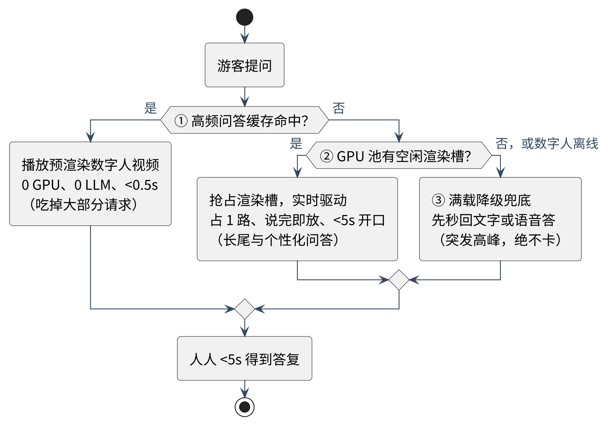{ width=77% }

**图 4-8　并发与成本的三层漏斗（请求按成本由低到高逐层下沉）**

**L1 高频问答视频缓存（最大成本节约点）**。景区问答高度重复，"大佛多高""门票多少""厕所在哪"等长尾极度集中。本系统把 Top-N 高频问答离线预渲染成数字人视频片段并缓存，命中即直接播放成品视频，0 GPU、0 LLM、小于 0.5 秒。系统已有文本答案 LRU 缓存（实测命中 0.03s），L1 相当于它的视频版。迎宾、固定景点讲解、路线介绍等固定内容全部预渲染，常态零实时 GPU，命中率越高、均摊成本越趋近于 0。该层已实现：桥接层入口先做归一化子串匹配，命中即短路返回缓存视频，不调 RAG、不占渲染槽；前端在舞台直接播放成品视频、播完回归；预渲染由专门脚本在 GPU 主机上抓流驱动生成并热加载。实测命中 0.001 至 0.004 秒，对比走 RAG 的 8.9 秒快约数千倍，且零 GPU 与 LLM 成本。

**L2 GPU 池与按发话调度**。多块 GPU 组成渲染池，游客发话时抢占一个空闲渲染槽，复用既有的首句抢跑流式机制（RAG 出第一句即送渲染、小于 5 秒开口），说完后槽位按估算说话时长自动释放，立即被下一个游客的发话复用。由前述稀疏性，一块 GPU 实测可服务约 50 至 80 名游客每小时（朴素独占模式仅 1 至 2 人）。该层的多 GPU 调度算法（分发、容量精算与预测式伸缩）较为独立，单独成节说明。

**L3 满载降级兜底（保证人人有答复）**。突发大客流占满 GPU 池、或数字人服务离线时，该条请求自动降级为纯文字或语音答复：答案照常秒回（逻辑后端高并发零压力），只是这一条没有会动的脸。产品约 80% 的价值（问答、路线、定位、游记）不依赖实时渲染，降级近乎无感。这一层确保任何请求都不会因 GPU 占满而得不到答复。

### 4.7.5 关键机制与实现

三层漏斗中的 L2 容量池与 L3 降级已在桥接层落地并实测，核心机制如下：

- **渲染容量池**：以"槽位"建模 GPU 并发，提供非阻塞抢槽与说完后异步释放，直接实现按发话占用、说完复用；池大小可按部署的 GPU 卡数配置。
- **容量决策**：每次发话在驱动前判断数字人是否可用且抢到槽位，是则驱动数字人，否则不驱动、只收集文字答复并标记降级原因（池满或数字人离线），答案永远返回。
- **负载观测**：提供容量查询接口，暴露池大小、占用数、可用数与数字人在线状态，供运维与数据大屏监控。
- **流式基元**：L2 复用既有的首句抢跑机制（每出一句立即驱动），这是边渲染边播放、压住 5 秒红线的关键。
- **前端协同**：游客端读取降级标志，降级时展示"文字模式・繁忙"提示，体验诚实不欺。

### 4.7.6 性能与成本

在延迟方面，各环节实测如下表：

**表 4-27　并发与成本方案的延迟实测**

| 环节 | 延迟 | 测法 |
|---|---|---|
| 软件链路（问完到数字人收到开口驱动）| 冷 2.28s / 热均 1.61s / 缓存 0.03s | 打点实测 |
| Qwen-TTS 首音 | 0.35s | 流式首包实测 |
| 渲染首帧加推流缓冲 | MuseTalk 约 0.2s / Ditto 0.72s，另加约 0.8s（FLV） | 实测加架构估值 |
| 软件链路到 FLV 首帧（问完到看见开口，不含 VAD 与 ASR） | 约 3.0s（MuseTalk）/ 约 3.5s（Ditto），冷启动再加 0.6s | 与 NFR-2 的说完到开口口径不同 |

时延关键主干（软件 1.61s 加 TTS 0.35s，共 1.96s）实测明确小于 5 秒。

在降级容量方面，池大小为 1 时让两个游客同时提问：一个驱动数字人，一个自动降级为文字（原因为池满），两人都拿到答案、无人阻塞或报错；数字人离线时同样稳定降级，答案照出。

在成本方面，与真人导游的对比如下表：

**表 4-28　数字人方案与真人导游的成本对比**

| | 真人导游 | 数字人方案 |
|---|---|---|
| 服务模式 | 1 人带 1 团（约 20 至 30 人），不能一对一 | 一对一、无限并发（弹性扩池）|
| 时长与语言 | 8 小时、单语 | 24 小时、多语言、不知疲倦 |
| 单位成本 | 导游 300 至 500 元每天除以约 20 人，即每人 15 至 25 元 | 每游客低于 1 元（见下）|

数字人单游客成本（按逗留 3 小时、问 10 次估算）：L1 缓存命中部分约 0 元（播成品视频）；L2 实时渲染按云 GPU 3 至 6 元每小时除以约 80 名游客每小时，约 0.05 至 0.08 元每游客；LLM 与 TTS 约 0.3 至 0.5 元每游客。合计低于 1 元每游客，比真人导游人均低一个数量级以上，且支持一对一、24 小时、多语言与弹性无限并发。

### 4.7.7 落地路径

**表 4-29　规模化落地路径**

| 阶段 | 改造 | 状态 |
|---|---|---|
| 现状 | RTMP 单路直播，1 会话独占 | 演示级 |
| L3 降级兜底与 L2 容量池 | 桥接层容量池，满载或离线自动转文字，容量查询 | 已落地并实测 |
| L1 高频问答视频缓存 | 清单、命中短路、前端舞台播片、预渲染脚本、热重载 | 框架已落地并实测 |
| L2 完整 GPU 池 | 多 GPU worker、调度队列、弹性伸缩 | 规模化阶段 |
| 逻辑后端水平扩 | 多 worker 加负载均衡，SQLite 迁移至 PostgreSQL | 规模化阶段 |

### 4.7.8 诚实边界与风险

- **当前 GPU 池实测为单槽**：完整多 GPU 调度与弹性伸缩属规模化阶段工程，本节已落地的是容量抽象与降级底座，多卡只需调整池大小配置并接入 GPU worker。
- **缓存命中率是成本的关键变量**：景区问题重复率高使命中率乐观，但需上线后用真实热点话题数据持续校准预渲染清单。
- **降级文字答复的首字延迟**：当前降级时返回整段答复（非流式），文字模式的感知延迟接近整答时长，可后续让文字模式直连流式问答进一步压低。
- **HLS（iOS）分段缓冲**比 FLV 高 1 至 3 秒，是端到端延迟的变量，需真机校准。

### 4.7.9 小结

本方案以 GPU 按发话共享、高频内容预渲染缓存、满载降级兜底三层漏斗，把"每位游客独占一块 GPU"的不可承受成本，转化为"少量 GPU 服务大量稀疏发话、大部分请求零成本缓存命中"。在保证人人 5 秒内及时答复（降级永不卡）的同时，将单游客成本压到 1 元以下、远低于真人导游，这是本产品从"能演示"走向"可规模化运营"的关键支撑。

## 4.8 L2 多 GPU 池调度算法设计

本节给出三层漏斗中 L2 层（GPU 池按发话共享）的算法详细设计：先界定问题特征，再横评工业界（Triton、vLLM、Ray Serve）与学术界的算法族，给出分层调度器，用排队论做容量规划（含算例），最后讨论弹性伸缩与诚实边界。

### 4.8.1 问题界定

把实时数字人渲染的调度问题与常见的无状态 Web 或 LLM 推理对比，有四个使它特殊的特征：

**表 4-30　调度问题的特殊性**

| 特征 | 本系统 | 对调度的影响 |
|---|---|---|
| 任务粒度 | 一次发话渲染约 10 至 20 秒实时渲染（长任务，非毫秒级）| 单任务久，队列等待对尾延迟敏感，需排队论精算 |
| 到达过程 | 稀疏且突发（游客问完后沉默 1 至 2 分钟）| 高变异性，Erlang-C 要求留远超均值的余量 |
| 服务质量约束 | 首帧开口小于 5 秒 | 调度目标是最小化分配到空闲 GPU 的等待 |
| 状态与亲和 | GPU 装载某 avatar 有冷启动成本，不同景区用不同 avatar | 亲和与均衡的经典张力：同景区请求应粘到已热 GPU |

此外，本系统已有准入前置：L1 命中则不进 GPU、池满则 L3 降级，因此调度器只处理必须实时渲染的那一小部分请求，问题规模已被前两层大幅削减。本系统还有一项通用系统不具备的优势：拥有真实客流数据（行为数据加时段模型），可据此做预测式伸缩。

### 4.8.2 算法族横评

**分发策略（请求落到哪块 GPU）**。常见分发算法及其在本系统的取舍如下表：

**表 4-31　分发算法族横评**

| 算法 | 原理 | 用于本系统的取舍 |
|---|---|---|
| Round-Robin / 随机 | 轮流或随机派发 | 简单但忽略负载与 avatar 热度，长任务下尾延迟差 |
| Join-Shortest-Queue (JSQ) | 派给当前最短队列 | 近优，但需全局实时负载、协调开销大，且无视 avatar 热度，可能每次落到冷 GPU |
| Power-of-Two-Choices (Po2C) | 随机选 2 个，派给较空者 | 最大负载从 Θ(log n) 降到 Θ(log log n)，协调开销极小；研究指出取二（d=2）还能保住缓存局部性，取更多反而打散热度 |
| 一致性哈希有界负载 (CHBL) | 按 key 哈希到固定 GPU（亲和），但单机负载封顶（如不超过均值的 1.25 倍），超限则溢出到下一个 | Google 与 Vimeo 的生产算法，同时获得亲和与均衡，正是 avatar 热度问题的解 |

学术界为分布式 LLM serving 同时做缓存亲和与负载均衡的最新工作（如 DualMap）印证了这条路线：纯亲和会在热点景区下产生热点，纯均衡又会丢失 avatar 热度，CHBL 与 Po2C 的组合恰好兼顾两者。

**单机队列内调度**。由于本系统任务时长相近（约 15 秒）且首帧已快速流式回传，单机用 FIFO 即可，准入层也已削峰；当存在混合优先级（如实时对话流优先于离线预渲染批作业）时，则改用 EDF（最早截止优先），按 5 秒截止排序。

**关于批处理的诚实说明**。LLM serving 的关键加速手段是连续批处理（continuous batching，如 vLLM 与 Orca 在解码阶段做 token 级跨请求拼批，吞吐可提升约一个数量级）。但实时数字人不适用跨用户拼批：每个用户是一条独立的"音频到帧"流，无法像 LLM 解码那样合并；MuseTalk 的 batch 仅发生在单用户帧内，Ditto 同理为单用户音频滑窗串行推理。因此 L2 的增益来自时分复用（multiplexing）而非拼批，这是它与 LLM 调度最本质的区别，必须如实写明。

**自动伸缩**。反应式策略按队列长度或等待时间阈值扩容、按低利用率缩容、闭园时段缩到零；预测式策略按负载曲线提前预热（如 Aladdin 用装箱求满足 SLO 的最小成本配置，报告可省约 71% GPU）。冷启动方面，扩容较慢（装载引擎与 avatar 需数十秒），故保留 N_min 台热机并预载各景区默认 avatar；换 Ditto 后冷启动更轻，avatar 仅是一张源肖像图（MuseTalk 需预烘帧序列），且 2.7G 显存（相对 7.2G）使同卡可热驻的实例密度提升约 2.6 倍。

### 4.8.3 分层调度器

该调度器分层组织，如图 4-9 所示。

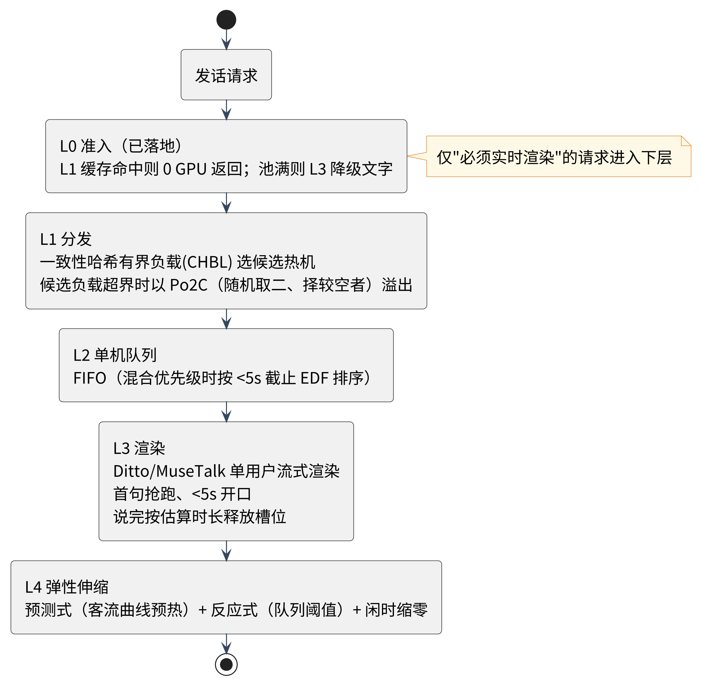{ width=77% }

**图 4-9　L2 GPU 池分层调度器**

整体策略可概括为：以 CHBL 保 avatar 亲和、省去冷启动，以有界负载与 Po2C 防止热点、保持均衡，以 FIFO 或 EDF 守住 5 秒截止，以时分复用而非拼批提升单卡服务人数，并以客流预测驱动弹性伸缩。

### 4.8.4 容量规划

把 GPU 池建模为 M/G/c 队列：设泊松到达率为 λ（发话每秒）、平均服务时长为 $\overline{S}$（约 15 秒）、GPU 数为 c。其 offered load（厄朗数）与利用率为：

$$
a = \lambda \cdot \overline{S}\quad(\text{单位：Erlang}),\qquad \rho = a/c
$$

由 Erlang-C 公式可得"到达即需排队"的概率 $P_{\text{wait}}$ 与期望排队等待 $\mathbb{E}[W_q]$：

$$
P_{\text{wait}}=C(c,a)=\frac{\dfrac{a^{c}}{c!}\cdot\dfrac{c}{c-a}}{\sum_{k=0}^{c-1}\dfrac{a^{k}}{k!}+\dfrac{a^{c}}{c!}\cdot\dfrac{c}{c-a}},\qquad
\mathbb{E}[W_q]=\frac{C(c,a)}{c-a}\,\overline{S}
$$

据此反解满足 p95 等待小于 1 秒（叠加约 3 秒流水线后端到端小于 5 秒）所需的最小 c。

作为算例（用以展示 L1 缓存如何直接减少 GPU 数），设某景区高峰发话率 λ = 1 次每秒、平均服务时长 S = 15 秒：无 L1 缓存时，offered load a = 15 Erlang，要满足 p95 低等待，Erlang-C 需约 19 至 20 块 GPU；有 L1 缓存（命中率 50%）时，实际进入 GPU 的到达率降至 0.5 次每秒，a = 7.5 Erlang，约需 10 至 11 块；若再叠加 L3 对极端高峰约 5% 的降级，峰值到达率进一步下削，所需 c 还可更低。这一算例量化了三层漏斗的价值：L1 把所需 GPU 数减半，L3 削掉峰值尾部。

需要修正的是，当到达突发且服务时长高变异时，M/M/c 模型会低估尾延迟，应改用两矩 M/G/c 近似；研究指出极端突发负载可能需要平滑负载约 8 倍的容量。因此实际应按峰值小时到达率与变异系数留余量，宁可弹性多备、闲时缩零。

### 4.8.5 弹性伸缩

1. **预测式（核心优势）**：用已有客流数据（真实 14 万行行为加时段与季节模型）预测每小时到达率 λ，经 Erlang-C 反解所需 GPU 数 c，提前预热对应数量的 GPU，把数十秒的冷启动藏在需求到来之前。这是通用系统不具备的前瞻能力。
2. **反应式兜底**：队列等待超过阈值即扩容，利用率持续偏低即缩容。
3. **缩到零**：景区闭园时段池缩零，成本归零。
4. **冷启动缓解**：保留 N_min 台热机，并让每景区默认 avatar 常驻其亲和 GPU。

### 4.8.6 与已落地组件的对接

- 已落地的渲染容量池（单节点槽位计数加按说话时长释放）是 c=1 的特例；多节点版只需把本地计数换成池级状态（用 Redis 或 etcd 记录各 GPU 负载与 avatar 热度），并在分发层套上 CHBL 与 Po2C。
- 已落地的容量查询接口即池级观测的雏形，可扩展为每块 GPU 的负载与热度上报。
- 已落地的发话埋点正是预测式伸缩所需的到达率数据源，数据闭环已经就位。

### 4.8.7 诚实边界

- 实时数字人不能跨用户拼批，L2 增益来自时分复用，规模上限仍受单卡实时渲染吞吐约束。
- 多节点 CHBL 与 Po2C、池级状态、预测式伸缩均属规模化阶段工程，当前落地的是单节点容量池抽象加降级，已为多节点预留接口。
- Erlang-C 假设泊松到达，而真实景区到达更突发，需用真实数据持续校准到达率与变异系数。

### 参考来源
- [Consistent Hashing with Bounded Loads (Mirrokni & Thorup, arXiv:1608.01350)](https://arxiv.org/pdf/1608.01350) — 亲和+有界负载
- [改进负载均衡的一致性哈希算法 (Vimeo Engineering)](https://medium.com/vimeo-engineering-blog/improving-load-balancing-with-a-new-consistent-hashing-algorithm-9f1bd75709ed)
- [DualMap: Enabling Both Cache Affinity and Load Balancing for Distributed LLM Serving (arXiv:2602.06502)](https://arxiv.org/pdf/2602.06502)
- [The Power of Two Choices with Simple Tabulation (arXiv:1407.6846)](https://arxiv.org/pdf/1407.6846)
- [inference-fleet-sim: A Queueing-Theory-Grounded Fleet Capacity Planner for LLM Inference (arXiv:2603.16054)](https://arxiv.org/pdf/2603.16054) — Erlang-C/M/G/c 容量规划
- [From Models to Operators: Rethinking Autoscaling Granularity for Large Generative Models (arXiv:2511.02248)](https://arxiv.org/pdf/2511.02248)
- [LLM Inference Scheduling: A Survey (techrxiv, 2025)](https://www.techrxiv.org/users/994660/articles/1355915) — 调度技术综述
- [Load Balancing for AI Inference (Introl)](https://introl.com/blog/load-balancing-ai-inference-distributing-requests-1000-gpus) — 动态批处理/调度工程实践

## 4.9 算法设计综述

每一项算法设计都对应一条赛题要求，并有实测证据支撑，对照如表 4-32 所示。

**表 4-32　算法设计与赛题红线对照**

| 算法 / 机制 | 对应赛题要求 | 实测证据 |
|---|---|---|
| 混合检索、重排与自主设计的 EA-RAG | 问答准确率不低于 90%（硬性红线） | 97.1%（105 题严格自动评分，人工复核 100%）；消融实验 41.0% 提升至 97.1%，提升 56.1 个百分点 |
| 置信度门控与四道防幻觉纵深 | 系统可信、不得编造 | 陷阱题 15 道全部正确应对；门控阈值经标定（库外拒答 60%、正常零误拒） |
| 插拔式知识库与命名空间隔离 | 知识库可管理、可更换 | 8 景区同一套代码运行，其中 5 景区评测均达标，新增景区只需上传文档加三行配置 |
| 多智能体意图分派与同行人格 | 个性化讲解与路线推荐 | 五类意图（规则命中零开销）；四种人格实测输出显著差异化 |
| 客流、天气与时间情境注入 | 随机应变的真导游体验 | 基于 14 万行真实行为数据建模，错峰建议自然融入回答 |
| qwen-vl 两段式视觉定位 | 至少 1 个多模态大模型（硬性） | 拍照、识别地标、知识库接地讲解与指路 |
| Ditto 全脸驱动与 TensorRT | 口型同步、表情自然 | 25.5fps 实时、首帧 719ms、显存 2.7G；情绪随情绪标签联动 |
| 句子级流式与四项延迟优化 | 交互响应延迟合理（赛题例小于 5s） | 语音端到端约 4.4s；RAG 首句 p50 1.35s、p95 1.8s |
| 三层漏斗与 GPU 池按发话调度 | 系统稳定、不崩溃、可运营 | L1 缓存命中 0.001s；满载降级实测人人有答案；单游客成本低于 1 元 |

对应本章开头的五方面要求：准确（97.1%）、懂游客与情境（意图、人格、情境、视觉）、自然（25.5fps 全脸）、及时（约 4.4s）、可运营（单游客低于 1 元），均有可复现的实测数据支撑。

---

# 第 5 章 功能模块设计

本章从数据流转的角度说明各功能模块，即一次交互如何在前端、桥接层、后端与存储之间流动，而非罗列界面，分游客端（5.1）与管理端（5.2）两部分。

## 5.1 游客端功能模块

### 5.1.1 问答交互模块

文本、语音、拍照三种输入统一经桥接层处理，转为 RAG 的句子级 SSE 流，再逐句驱动数字人开口（首句抢跑、5 秒内开口）。其数据流转为：前端把请求发往桥接层，桥接层先判断 L1 缓存是否命中，命中则直接返回成品视频，否则订阅 RAG 的问答流，每生成一句即驱动数字人说出，并将音视频推流回传；语音输入先经 ASR 转写，拍照输入则走两段式视觉定位。

### 5.1.2 行程关怀模块

主动迎宾在游客一连接时触发，数字人按当前景区的导游名与同行人格微笑打招呼，作为开场环节。电子游记与明信片则在游览结束时由服务端生成温暖回顾，前端用 Canvas 合成（景区背景叠加到访景点、徽章、祝福与导游落款），可保存分享。

### 5.1.3 画像驱动个性化模块

本系统在游客端贯穿一套以画像为驱动的个性化层，使同一套代码按游客画像呈现不同的内容。画像由三部分构成：同行类型（独自或结伴、亲子家庭、老年长辈、情侣）、五维自身情况（年龄段、游览节奏、出行方式、此行目的、是否初访）与兴趣偏好（历史人文、自然风光、拍照打卡、特色美食、禅意文化），三者正交。这些信息在进入导览前以分步引导轻量采集，游客可在游览中途随时调整，调整后相关呈现即时重算。

个性化主要体现在首页的为你定制推荐区。其数据流转为：前端把画像、景区与语言发往推荐接口，服务端按同行类型、兴趣偏好、景区，以及当前的天气、客流与时段，组装提示后交由大模型生成三张结构化推荐卡。每张卡含图标、标题、一句第二人称的推荐理由、若干依据标签（如亲子、历史、傍晚、人少）与一个跳转动作（问导游、开路线或开设施）。为防止幻觉，提交给模型的候选只包含本景区的真实景点、活动与设施，模型只在其中挑选，讲解事实仍由游客点开后的 RAG 链路约束。生成结果按景区、画像与时段分桶缓存，命中即复用。

画像不止用于推荐区，而是贯穿游客端各处的统一个性化层，下表给出主要落点。

**表 5-1　画像在游客端的落点**

| 落点 | 按画像呈现的差异 |
|---|---|
| 为你定制推荐卡 | 同行类型与兴趣加此刻情境，生成带理由与依据的三张推荐 |
| 快问建议 | 亲子优先带孩子玩什么与母婴室，长辈优先哪里歇脚与无障碍，命中兴趣再补一项，四语本地化 |
| 设施速查排序 | 亲子前置母婴室与卫生间，长辈前置休息点、医务与无障碍，并附一句为你优先排序的说明 |
| 推荐路线 | 命中画像的路线置顶并标注推荐徽章 |
| 主动贴心提醒 | 按画像与当前时段给一句关怀，并入今日游园卡，与天气提示互补 |
| 电子游记寄语 | 明信片落款按本程足迹与画像生成个性化收尾，无足迹时回退景区通用祝福 |

画像数据由此形成双向闭环：同一份画像在游客端产出个性化体验，在管理端经埋点回流后产出运营洞察。游客端对推荐区的曝光与对每张卡的点击分别埋点上报，服务端据此向管理端数据大屏提供推荐效果分析，包含曝光数、点击数、点击率、热门推荐与动作分布；客群画像的同行类型、语言与兴趣分布也来自同一套埋点。游客中途调整画像，游客端推荐实时重算，管理端洞察则随数据累积持续刷新。

### 5.1.4 跨设备接力与同游模块

游览过程常涉及多台设备，例如立屏问答后希望带着对话转到手机继续游览，或一家人各自用手机围绕同一行程同游。本模块以一次性令牌实现会话在设备间接力。数据流转为：源端把当前对话历史与画像提交到接力创建接口，服务端存表并返回一个不透明令牌；源端用自身访问地址拼出领取链接、渲成二维码展示；另一端扫码后凭令牌调领取接口取回快照，注水画像与历史并跳过开场引导，直接接续上一台设备的对话。

隐私与稳健性上有三点处理：会话快照不进二维码、只凭令牌从服务端取回；令牌五分钟过期即焚、有效期内可重复领取以容忍扫码重试；公共立屏二维码按需生成、带倒计时自毁、不常驻。机制双向对称，立屏到手机用于带走导览，手机到手机用于家人同游或换机续逛。

### 5.1.5 跟我游路线导览模块

本模块把个性化路线落到一张可交互的地图上。其数据流转为：前端按景区与画像取得推荐路线后，在高德地图底图上渲染路线与各站点标记，游客每到一站拍照打卡即推进到下一站，形成边走边逛的引导。地图标记的颜色实时反映 POI 级客流档位（空闲、适中、较多、繁忙四色），并叠加演出场次与升降趋势箭头，使路线规划与错峰建议在同一张图上呈现，约每分钟刷新一次。坐标系上对高德的 GCJ-02 做了纠偏，使定位与标记位置一致。

## 5.2 管理端功能模块

### 5.2.1 知识库管理模块

知识库管理的数据流转为：管理员上传文档后，系统依双策略分块、用 BGE-M3 向量化，入库到 ChromaDB 中按景区隔离的 collection，并失效相关缓存。对外提供上传、查询、删除三个接口。由于换景区即换 collection，问答链路无需任何改动。

### 5.2.2 数字人形象配置模块

管理端与游客端通过一份互通契约协作：管理端配置各景区的默认形象与音色，游客端取默认值与可选目录后在其上精调。音色为消息级即时生效，每条驱动消息可携带音色；形象支持直播热切换，选定形象或换装后，正在直播的数字人约 1 秒内当场换装、不重连不断流。由于采用单路共享直播架构，形象切换为服务端进程态，所有观看者同步可见。

形象库采用多维标签分类，以风格主轴（推荐、现代、古风、民族）为主、性别为副筛，每个候选标注气质人设、服饰、年龄段与适配景区。身份库覆盖十余个数字人形象与六套换装服饰，并为多个景区绑定气质契合的专属导览形象。在此之外，系统提供自主形象生成，用 ComfyUI 配合 InstantID 锁脸换装，提供职业装、汉服、旗袍、民族、马甲、冬装六套服饰，体现形象可配置的能力。

景区主题换肤与深色模式两者正交叠加。每景区配置品牌主色与导游名，切换景区时整站换色；同时支持浅色、深色与跟随系统三种外观。在多语言方面，界面本地化为中、英、日、韩四种语言，问答引擎按 lang 参数支持九种语言，可自动跟随提问语言作答。

### 5.2.3 数据采集与数据大屏

数据采集与数据大屏由游客端、服务端与管理端三方协作完成，其数据流如图 5-1 所示。系统的数据采集对管理端透明：管理端只读取服务端提供的聚合接口，不直接接触底层数据表。

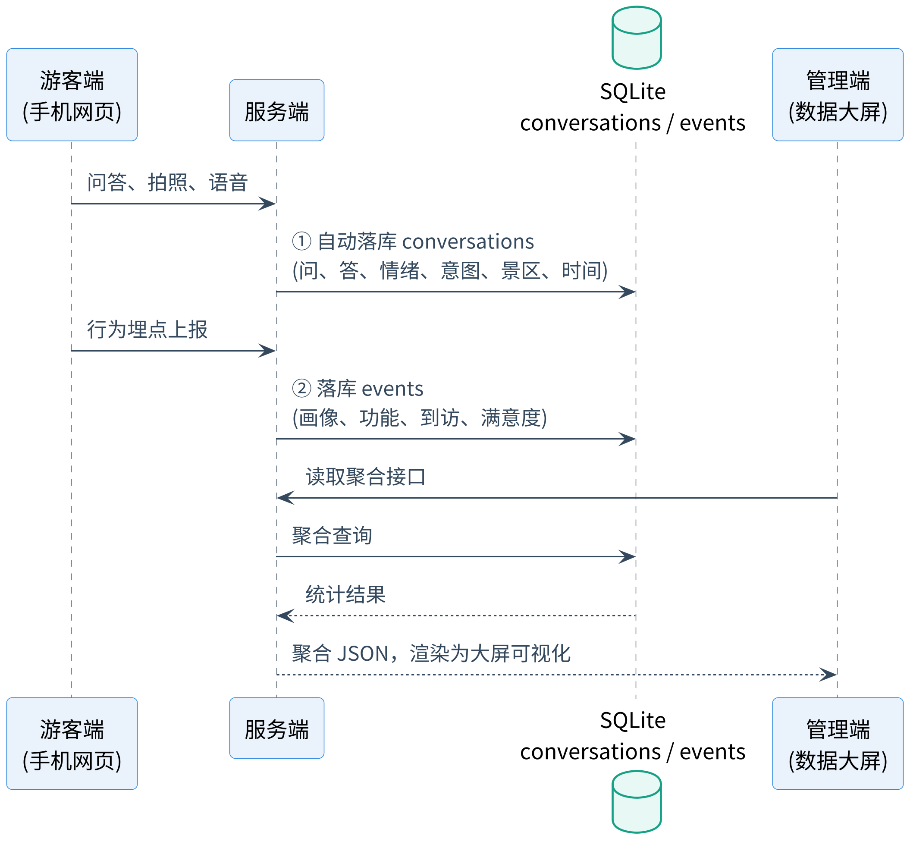{ width=73% }

**图 5-1　数据采集与大屏的数据流**

数据有两类来源。一是自动落库：游客每问一句，服务端即把对话内容、情绪、意图、景区与时间写入 conversations 表，无需客户端参与。二是主动上报：对于服务端从对话中看不到的信号（如同行类型、语言、兴趣、使用了哪些功能、到访了哪些站点、满意度），由客户端在相应时机埋点上报，落入 events 表。两张表统一存于 SQLite，管理端只读聚合接口。

管理端可读取九个聚合接口，覆盖概览、情感、热点、盲区、预警、客流、画像、功能与报告九个维度，如下表所示。所有接口均按景区与统计天数过滤，返回标准 JSON，供数据大屏直接渲染。

**表 5-2　数据大屏的聚合接口**

| 接口 | 用途 | 关键返回字段 | 大屏呈现 |
|---|---|---|---|
| 概览 KPI | 总体运营概览 | 会话数、会话人数、满意度、上下文命中率、情绪分布、每日趋势 | KPI 数字卡、情绪饼图、趋势折线 |
| 热门问题 | 高频提问 | 问题词与频次 | 词云、横向柱状 |
| 满意度趋势 | 情感按天变化 | 每日正面、中性、负面数与满意度 | 堆叠面积、满意度折线 |
| 知识盲区 | 答不上的问题 | 问题、出现次数、最近时间 | 列表，指导知识库补充 |
| 负面情绪预警 | 负面会话 | 会话、问题、情绪、时间 | 实时预警条 |
| 客流热度 | 各景点拥挤度 | 旺淡季、错峰时段、各景点拥挤档位与指数 | 拥挤档位条、错峰提示 |
| 客群画像 | 客群构成 | 同行类型、语言、兴趣占比 | 环图、占比、Top 柱状 |
| 功能使用率 | 功能与满意度 | 活跃会话、各功能打开次数、平均评分 | 功能使用柱状、满意度仪表 |
| 感受度报告 | 运营报告 | 大模型生成的报告文本 | 一键生成、渲染展示 |

其中客流热度接口仅在该景区存在于真实行为数据集时返回有效数据，否则如实标记为无数据。客户端在进入导览、打开功能、收听站点讲解、拍照定位成功、走完路线或生成明信片、退出会话等时机自动埋点上报，为客群画像与功能使用分析持续累积数据。上述各面板与接口共同覆盖了赛题对数据大屏概览、情感分析、知识库维护与游客感受度报告的要求。

---

# 第 6 章 数据库设计

本系统采用两类存储引擎。结构化的会话、行为与配置数据存入 SQLite，其优点是轻量、零运维、以单文件存放；非结构化的知识库向量存入 ChromaDB 这一专用向量库。本章先按概念模型、逻辑模型、物理模型三层展开 SQLite 设计，再说明向量库与外部行为数据集。整体存储设计如图 6-1 所示。

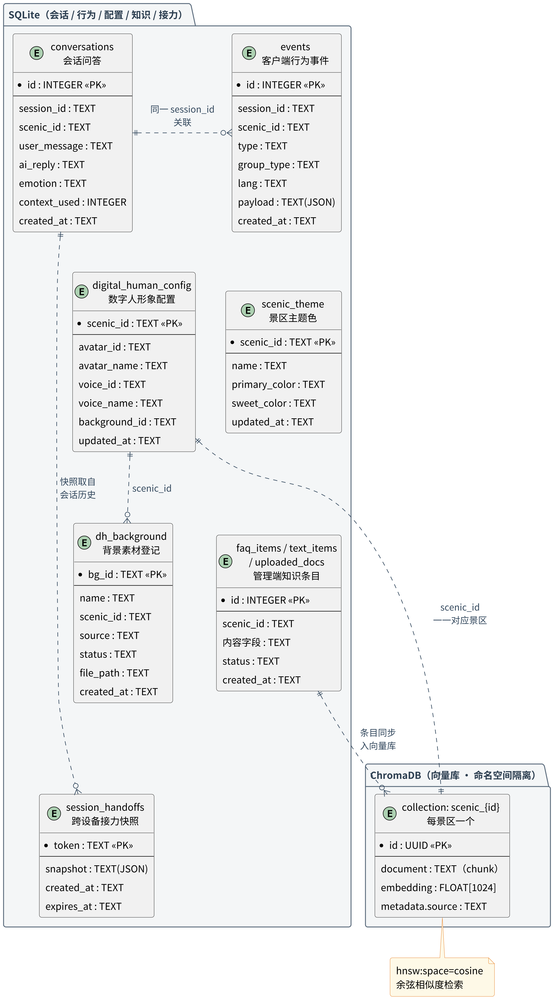{ width=100% }

**图 6-1　数据存储设计（SQLite 多表 + ChromaDB 向量库）**

## 6.1 关系型数据库设计

### 6.1.1 概念模型

从业务视角，系统需要持久化的实体分为三组。

运行数据随游客交互不断增长，包含两类。一是会话问答，即每轮游客提问与数字人回答的记录；二是行为事件，即客户端上报的画像、功能使用、到访、满意度等埋点。二者通过 session_id 关联到同一次游览会话。

配置数据按景区维护，管理端可修改，包含三类。一是数字人形象配置，即每景区的默认形象、音色与背景；二是景区主题色，即每景区的品牌配色与导游名；三是背景素材登记，即管理端上传的自定义场景背景。三者均以 scenic_id 为业务主键，与插拔式景区一一对应。

知识与接力数据包含两类。一是管理端维护的知识条目，含 FAQ 问答对、文本片段与上传文档登记，与向量库同步，支撑知识库的结构化管理；二是跨设备接力的一次性会话快照，短时存活，过期即清除。

### 6.1.2 逻辑模型

将概念实体映射为下列数据表，字段与键设计如下：

**表 6-1　SQLite 数据表的逻辑模型**

| 表 | 主键 | 关键字段 | 用途 |
|---|---|---|---|
| `conversations` | `id` (自增) | session_id / scenic_id / user_message / ai_reply / emotion / context_used / created_at | 每轮问答自动落库（服务端埋点）|
| `events` | `id` (自增) | session_id / scenic_id / type / group_type / lang / payload(JSON) / created_at | 客户端行为上报（画像/功能/到访/满意度）|
| `digital_human_config` | `scenic_id` | avatar_id / avatar_name / voice_id / voice_name / background_id / updated_at | 景区数字人默认形象+音色+背景 |
| `scenic_theme` | `scenic_id` | name / primary_color / sweet_color / updated_at | 景区主题色与导游名覆盖（管理端可配）|
| `dh_background` | `bg_id` | name / scenic_id / source / status / file_path / created_at | 管理端上传的自定义背景登记 |
| `faq_items` / `text_items` / `uploaded_docs` | `id` | scenic_id / 内容字段 / status / created_at | 管理端维护的知识条目，新增或编辑即以稳定 id 同步进向量库 |
| `session_handoffs` | `token` | snapshot(JSON) / created_at / expires_at | 跨设备接力的一次性会话快照，TTL 5 分钟、过期即焚 |

主键设计体现了三类实体的差异。运行数据采用自增 id，一次会话对应多条记录，按追加方式写入；配置数据以 scenic_id 作主键，每景区一行，借助冲突即更新的写入方式实现存在则改、不存在则插的语义；接力快照以不透明 token 作主键，并附带过期时间戳。

### 6.1.3 物理模型

落到 SQLite 的物理实现，有三处工程化设计。

在索引方面，按查询模式建立复合索引。conversations 表按景区与创建时间建立复合索引，支撑大屏按景区与时间范围聚合；events 表分别按事件类型与创建时间、按景区与创建时间建立复合索引，支撑画像与功能统计；另对 session_id 单列建索引，支撑按会话拉取历史，用于行程游记与上下文改写。

在时间戳方面，创建时间字段默认由数据库侧按本地时区生成，避免应用层时区不一致。

在表结构迁移方面，SQLite 不支持按条件新增列的语法，而云端已有存量库。为此封装一个幂等的加列函数，先查询表的列信息，再决定是否执行新增列操作，使新增字段（如形象配置表的背景字段）对新旧库都安全，且可重复执行而不报错。

## 6.2 非关系型数据库设计

知识库的需求是为一段文本匹配一个高维向量并做相似度检索，不适合关系建模，故本系统采用 ChromaDB，其设计分三个方面。

在命名空间隔离方面，每个景区对应一个独立 collection，命名为 scenic_{id}。这是插拔式知识库的物理落点，新增景区即新建一个 collection，与既有景区互不干扰，也杜绝跨景区串答。

在存储结构方面，每条记录由三部分组成：document 为分块文本，embedding 为 BGE-M3 输出的 1024 维向量，metadata 记录来源文件与分块策略等信息。

在检索配置方面，以 hnsw 索引配合余弦相似度做近似最近邻检索。

## 6.3 行为数据集

赛题提供的 14 万行游客行为数据，含年龄、满意度、花费、景点访问量等字段，不进数据库，而是作为只读统计源被客流分流算法与数据大屏直接加载。它属于历史聚合数据，而非交易数据，按文件加载并缓存统计结果即可，无需建表。

---

# 第 7 章 数据交互设计

本章说明前后端之间的数据交互，包括问答的流式时序、数字人推流链路与桥接层协议三部分。

## 7.1 流式问答时序
问答接口按固定事件序下发四类事件：intent 最早下发，供前端展示当前意图；emotion 在第一句之前下发，使数字人表情与回答内容一致；sentence 逐句下发，共 N 句；end 表示一次回答结束。桥接层订阅该事件流，每收到一句即驱动数字人开口，无需等待整段回答生成完毕，由此把交互延迟控制在较低水平。完整时序如图 7-1 所示。

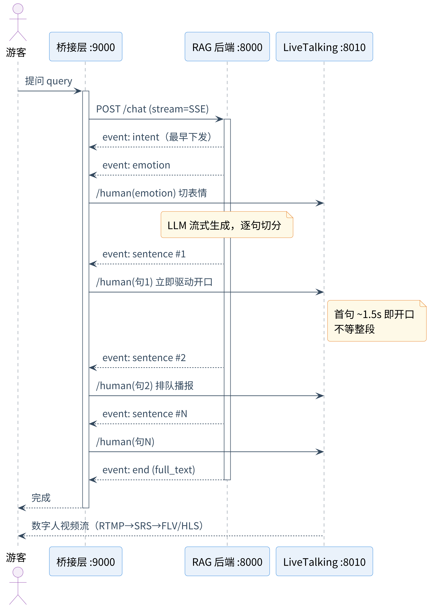{ width=73% }

**图 7-1　流式问答 SSE 事件时序**

## 7.2 数字人推流链路
数字人视频经 LiveTalking 以 RTMP 推出，由媒体服务器转为 HTTP-FLV 或 HLS 两种格式：安卓端使用 mpegts.js 播放 HTTP-FLV，iOS 端使用原生播放器播放 HLS。桥接层提供流媒体反向代理，使前端可在同源条件下正常播放，避免跨域限制。完整推流链路如图 7-2 所示。

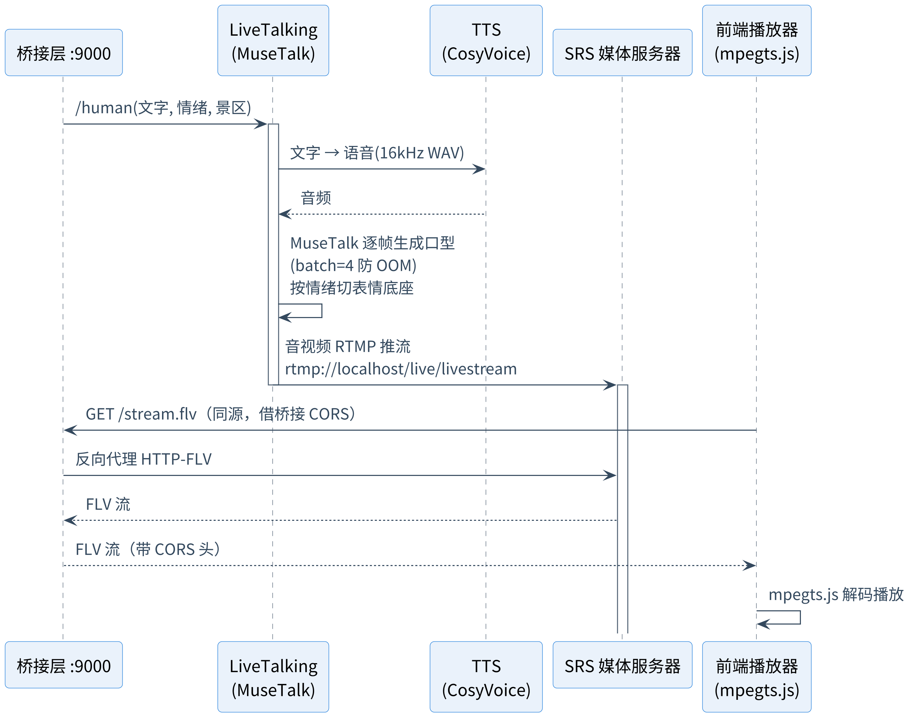{ width=96% }

**图 7-2　数字人推流链路（RTMP → SRS → FLV/HLS）**

## 7.3 桥接层协议
桥接层在游客端与后端之间承担转接与编排，对外提供一组直播相关端点。提问端点是核心入口：先尝试命中高频问答缓存，命中即直接返回缓存结果，未命中再做容量决策并按请求覆盖音色，随后触发流式驱动。朗读端点让数字人直接说出指定文字。形象端点在建立连接时返回该景区的数字人形象。容量端点用于观测容量池的占用情况。缓存重载端点用于热更新高频问答缓存。

---

# 第 8 章 接口、异常与工程严谨性

本章说明对外接口的组织、异常与降级机制以及性能工程实现，集中体现系统的工程严谨性。

## 8.1 对外 API

系统对外提供一组按功能分组的 RESTful 接口。对话类接口处理文本问答与图文问答；知识库管理类接口支持文档上传以及问答条目、文本条目的增删改查；数据分析类接口提供游客画像、功能使用统计与事件上报，并设有面向运营的商业智能子接口。此外还包括个性化推荐、拍照打卡定位、数字人形象配置、景区主题、行程关怀、跨设备接力、路线与设施、语音识别等接口，覆盖游客端与管理端的主要业务场景。

## 8.2 异常处理与降级

系统在多个环节设有降级与容错机制，以保证在资源受限或外部依赖不可用时仍能正常响应。数字人渲染容量满载或离线时，自动降级为纯文字答复，使并发场景下每位游客都能得到回答。调用大模型遇到拒绝访问时，切换到可用的稳定版本，并对返回状态码做防御性判断，避免空响应导致的异常。天气数据获取失败时仅使用时间信息，不影响主流程。空会话与无数据场景均做妥善处理。语音识别模型采用懒加载，使不含该依赖的云端环境也能正常启动。

## 8.3 性能工程

系统在性能上做了多项工程优化。答案缓存采用 LRU 策略，使高频问题在毫秒级返回。高频问答视频缓存使命中请求在毫秒级返回且不占用 GPU。检索环节采用并行异步以缩短链路耗时。语音识别在 CPU 上运行，把整块 GPU 留给数字人渲染。问答链路修复了同步迭代阻塞事件循环的问题，实现了真正的逐句流式下发。

---

# 第 9 章 界面设计

界面设计遵循与产品定位一致的通用原则。页面上出现的景区名、导游名、主题色均由后端按景区动态下发，UI 代码中不包含硬编码的景区信息。切换景区时，界面随之更换名称、主题色与导览名。

## 9.1 游客端

### 9.1.1 开场引导页

游客打开应用后的第一屏，通过一次选择完成个性化参数采集。所选项直接映射为后端接口参数，构成前端交互与后端人格的衔接入口。映射关系如下。

**表 9-1　开场引导项到后端参数的映射**

| 引导项 | 映射的后端参数 | 后端行为 |
|---|---|---|
| 想逛哪个景区 | `scenic_id` | 切换知识库 collection、导游名与主题色 |
| 和谁一起（独自、亲子、陪伴长辈、情侣） | `group_type` | 四种叙事人格切换 |
| 自身情况（年龄、节奏、出行方式、目的、是否初访） | `situation` 五维 | 因人而异的讲解指令，全默认时不影响缓存与准确率 |
| 感兴趣的（历史人文、自然风光、拍照打卡等，多选） | 兴趣偏好 | 注入推荐意图的个性化上下文 |
| 语言（中、英、日、韩） | `lang` | 多语言问答 |

开场引导页上半屏呈现品牌标识、数字人形象与景区选择。景区列表由后端动态下发，选中某景区后显示该景区的数字人导览名，提示游客可向其提问，切换景区时导览名随之更换（图 9-1）。下半屏以分步引导依次完成同行人格、五维自身情况与兴趣多选后进入导览，点选即跳转，每步均可跳过，全程跳过仍得到合法的中性画像（图 9-2）。界面支持深色模式全站换肤（图 9-3）与多语言即时切换（图 9-4）。

{ width=30% }

**图 9-1　开场引导页（上半屏）**

{ width=30% }

**图 9-2　开场引导页（下半屏）**

{ width=30% }

**图 9-3　深色模式**

{ width=30% }

**图 9-4　英文界面**

### 9.1.2 主交互页

主交互页以沉浸式数字人舞台为中心，配合三模态输入坞（语音、拍照、文字）、实时字幕、融合客流与天气的今日游园建议卡、快捷功能（跟我游、定位、设施、足迹）以及设置（语言、外观、数字人形象）。连接成功后数字人主动迎宾开口。

### 9.1.3 特色页面

特色页面包括形象 gallery（按性别与风格分面筛选，与管理端形象配置互通）与电子明信片（游记生成后一键导出，落款随景区动态变化）。

## 9.2 管理后台与数据大屏

管理后台包含知识库管理、数字人形象与主题配置，以及基于 ECharts 的数据大屏，大屏覆盖概览、情感、热点、知识盲区、预警、画像、功能使用与满意度等维度。管理端读取服务端的聚合接口，数据采集由客户端与服务端协作完成。

## 9.3 数字人形象展示

数字人主形象通过锁脸换装链路生成职业装、汉服、旗袍、民族服饰等多套形象，满足形象可配置的需求。情绪表情根据讲解内容输出的情绪标记进行切换，全脸表情随之变化。

---

# 第 10 章 项目特色与创新综述

本章先归纳系统的创新维度（10.1），再通过与现有方案的对比印证其差异化定位（10.2）。

## 10.1 创新维度

本系统的创新可分为两类：一是决定产品定位、与现有方案形成区别的核心创新，二是支撑这些能力落地的工程与产品创新。

核心创新有六项。

- 插拔式知识库与可量化的准确率承诺：换库不换码，导入任意景区知识库即可零改动复用，事实性问答准确率 97.1%（人工复核 100%、五景区均不低于 90%），并配一套自动派生全覆盖题、消融对照与陷阱题的可复现评测体系随源码交付。一个带准确率承诺的导览成品，是与平台类项目制交付、录播类固定内容最根本的区别。
- EA-RAG 检索编排算法：在通用的混合检索与重排之上自主设计实体锚定、查询自适应融合与置信度门控三个机制。门控经阈值标定，使系统对知识库外的问题诚实拒答（陷阱题 15 道全部正确应对）；实体锚定与查询自适应融合为知识库规模化时的召回鲁棒性预留。
- 主动式情境导游：由实时客流、天气、时间与空间主动触发讲解与错峰建议，承接真人导游随机应变的能力，而非等待提问的被动问答；客流建模基于赛题提供的 14 万行真实行为数据。
- 因人而异的个性化：同行人格、五维自身情况画像与兴趣偏好正交组合，使同一套代码按游客差异呈现不同的推荐、讲解、设施排序与游记寄语；全默认画像下问答缓存与准确率不受影响，做到泛化而不同质。
- 实时数字人自然度工程：直播引擎采用 Ditto 的驱动原图范式，使头、眼、颊、嘴协同运动以缓解面部僵滞，经 TensorRT 实时化达到 25.5fps、显存仅 2.7G，情绪以按句调速的韵律与原生表情条件外化、热切零停流。
- 可规模化运营与双端闭环：三层漏斗（高频问答缓存、GPU 池按发话共享、满载降级）把单游客成本压到 1 元以下并保证人人有答复；管理端把每一次对话沉淀为知识盲区、负面情绪预警与客流洞察，使数字人对游客是随身导游、对景区是可洞察的数字员工。

在此之外，支撑上述能力落地的工程与产品创新还包括：多模态视觉定位，拍照认地标后由知识库接地讲解指路，两段式设计抑制幻觉，并落实赛题至少一个多模态大模型的要求；跨设备接力与同游，扫码即可把对话与画像在立屏与手机间无缝接续；私有化与边缘部署，全栈可部署在景区本地、数据不出园区，渲染可下沉到边缘节点，弱网与高峰下仍有答复；以及多语言支持，界面四语、问答九语。

## 10.2 与现有方案对比

调研口径说明：以下竞品信息均来自各产品官网与公开报道（检索与截图日期为 2026 年 6 月），来源链接见本节末；对竞品未公开的信息（如报价、准确率）如实标注为"未公开"，不做推测。

### 10.2.1 现有方案全景

基准是真人导游。真人在讲解、带路与随机应变上是服务体验的参照标准，但成本约为每人次 15 至 25 元，旺季供给不足、服务半径有限、水平参差，且无法全天候待命，这也是各类数字化方案试图解决的问题。

第一类是录播语音导览，包括电子讲解器与三毛游一类的 App，是当前景区数字讲解的主流存量方案。以三毛游为代表，覆盖全球一万五千多个景区与博物馆，由专业主播录制内容，GPS 触发走到哪讲到哪，价格远低于真人导游与讲解器租赁。其形态为单向播放的录音库，游客不能提问，内容千人一面，新增或更新景点依赖重新录制，没有形象与交互，也没有个性化。

{ width=68% }

**图 10-1　三毛游官网首页：录播导览类代表，手机 App 加 GPS 定位讲解**

第二类是大厂数字人能力平台，如讯飞虚拟人、百度智能云曦灵数字员工、腾讯云智能数字人。这类平台级供应商在形象生成、语音交互与多终端 SDK 上能力成熟。文旅落地案例包括讯飞在西安大唐不夜城的唐小宝（星火大模型加景区专属知识库，提供讲解、活动查询与路线推荐）、百度的文博虚拟宣推官文夭夭与刘三姐文旅数字人、南昌滕王阁的 AI 数字人王勃。

{ width=68% }

**图 10-2　讯飞虚拟数字人官网：首页主推营销数字人，主战场为直播营销而非景区导览**

{ width=68% }

**图 10-3　百度智能云数字员工运营平台：平台级定位，文旅是其众多行业之一**

这类方案的差异主要在交付形态。景区拿到的是能力平台加定制项目，形象定制、知识库接入与终端集成均为项目制交付，讯飞方案页未公开标价、合作走商务对接，换一个景区相当于再做一个项目；公开材料中也未见以问答准确率为核心的量化评测口径，而准确率正是导览场景的关键要求。

第三类是景区自建定制项目，如各景区单点采购的数字人一体机。其体验取决于集成商水平，通常是单景区、单形象、单知识库的一次性交付，不具备跨景区复制能力。

### 10.2.2 差异化对比矩阵

**表 10-1　与现有方案的差异化对比矩阵**

| 对比维度 | 真人导游 | 录播导览 App / 讲解器 | 大厂数字人平台 | 本系统（途叨叨） |
|---|---|---|---|---|
| 交互形态 | 双向，可问答 | 单向播放，不可问答 | 双向问答（定制交付） | 双向问答加主动讲解（迎宾与情境触发） |
| 换景区或知识更新成本 | 重新培训导游 | 重新录制全部音频 | 重新立项定制 | 上传文档加三行配置（8 景区同码实证） |
| 准确率保证 | 因人而异 | 内容固定但不能回答提问 | 未见公开量化口径 | 97.1%（105 题）加可复现评测体系随源码交付 |
| 个性化讲解 | 看导游水平 | 千人一面 | 部分支持 | 四种同行人格、九种问答语言、兴趣偏好 |
| 情境随机应变（客流、天气、时间） | 具备，人的强项 | 不具备 | 未见 | 具备，基于 14 万行真实行为数据与实时天气注入 |
| 多模态视觉定位 | 人眼 | 仅 GPS，无视觉理解 | 部分平台具备图像能力 | 具备，拍照认地标后由知识库接地讲解指路 |
| 实时数字人形象 | 真人 | 无形象 | 成熟，核心强项 | 具备，Ditto 全脸驱动 25.5fps 加情绪表情联动 |
| 防幻觉可信度 | 可能口误 | 不适用 | 未公开 | 陷阱题 15 道全过，置信度门控经标定 |
| 单游客服务成本 | 每人次 15 至 25 元 | 低，单点讲解几元 | 项目制，未公开标价 | 低于 1 元每游客（三层漏斗） |
| 部署形态 | — | 公有云 App | 云 SaaS 或定制私有化 | 全栈可私有化，演示态单卡即可整机离线运行 |

### 10.2.3 定位小结

本系统的定位不是数字人形象生产平台，而是景区导览垂直场景的开箱即用成品。其差异化集中在五点：换库不换码的跨景区复制能力，平台类的项目制交付难以做到；可量化、可复现的准确率承诺，公开材料中未见同类口径；情境感知的主动导游，承接真人导游的随机应变，而录播类不具备；单卡即可私有化的全栈方案，数据不出景区；以及面向规模化的成本结构。录播类有内容而少交互，平台类有交互而非成品，本系统则是带准确率承诺的导览成品。

本节来源：[讯飞AI虚拟人智慧文旅解决方案](https://www.xfyun.cn/solutions/virtual-tourism-solution)、
[讯飞虚拟数字人官网](https://virtual-man.xfyun.cn/)、
[新浪科技：当数字人走进文旅](https://finance.sina.com.cn/tech/roll/2026-06-09/doc-iniavfsr5035692.shtml)、
[百度智能云数字员工运营平台](https://cloud.baidu.com/product/digitalhumansaas.html)、
[腾讯新闻：数字人战场，百度智能云](https://news.qq.com/rain/a/20240925A09AS400)、
[三毛游官网](https://sanmaoyou.com/)、
[鸟哥笔记：高德/携程/三毛游智能电子导览产品对比](https://www.niaogebiji.com/article-29256-1.html)、
[央视网：「AI+文旅」开启更智慧的旅程](https://culture-travel.cctv.com/2026/03/12/ARTIjuasqg4uj5aUE9uiMfyU260312.shtml)

---

# 第 11 章 结语

## 11.1 工作总结

本系统围绕景区导览场景，实现了插拔式 RAG 问答、多智能体主动导游、口型与表情同步的实时数字人、形象与主题可配置以及管理端数据大屏闭环，问答准确率达到 97.1%、语音端到端响应控制在 5 秒以内。在此基础上给出了面向规模化的并发与成本架构，三层漏斗中的缓存、容量池与降级已落地实测，完整的多 GPU 池调度属于后续规模化阶段。

## 11.2 应用价值与推广前景

插拔式架构使方案能够零改动复制到不同景区、博物馆、展馆与主题乐园，通用品牌途叨叨面向行业而非单一景区。系统全栈可私有化部署在景区本地，向量库、会话与配置数据不出园区，数字人渲染可下沉到景区的边缘算力节点，契合文旅与政企客户的数据合规与本地化诉求；配合高频缓存与满载降级，在客流高峰与弱网环境下仍保证有答复。面向管理方，系统在提供讲解服务的同时，把每一次对话沉淀为知识盲区、负面情绪预警与客流洞察，使数字人兼具讲解与运营两重价值。结合预测式弹性伸缩与显著低于真人导游的服务成本，一对一、全天候、多语言的导览服务在商业上具备可行性。

## 11.3 后续规划

后续可在以下方向继续推进。一是基于 SLAM 或 ARCore 的实景叠加 AR，将拍照定位升级为实景导航。二是进一步提升数字人自然度，并将挥手等肢体动作的实时手势引擎从离线开场推进到问答全程。三是 Android 客户端套壳，便于在景区现场分发与扫码使用。四是多节点 GPU 池调度落地，包含一致性哈希有界负载与预测式弹性伸缩。五是高频问答成片的全量预渲染，以进一步压缩响应延迟与算力成本。
