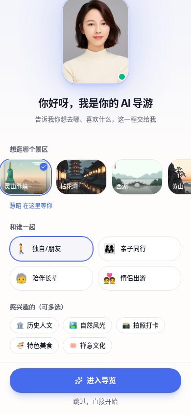
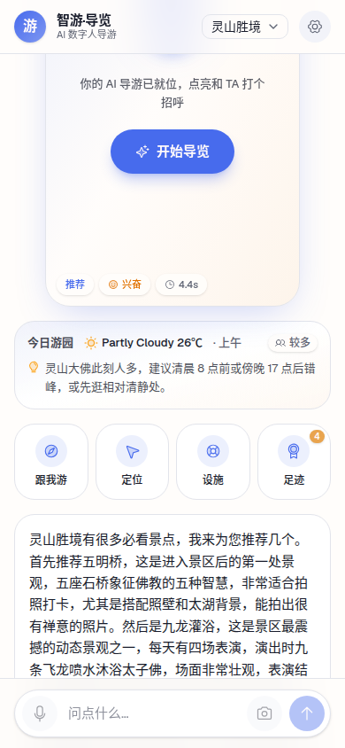
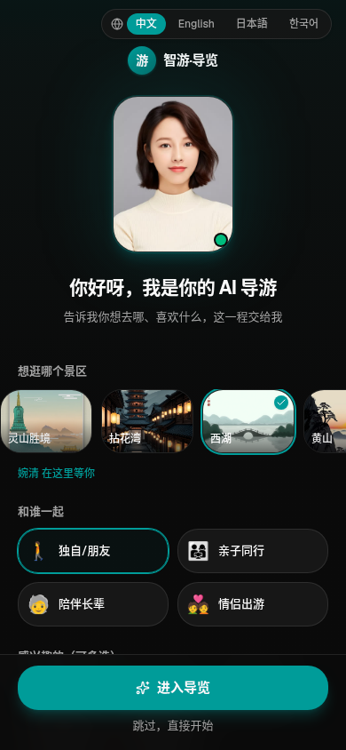
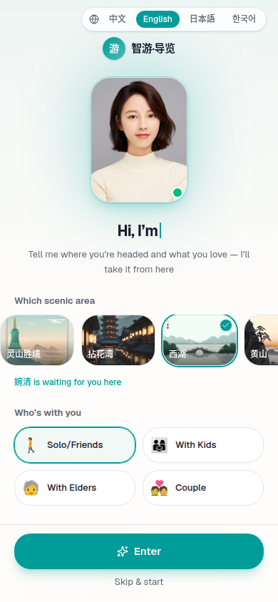
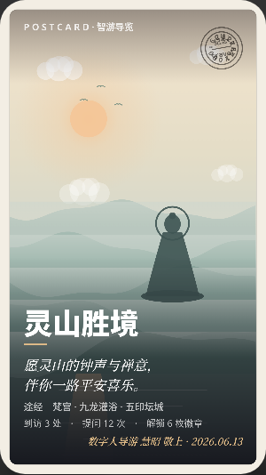

# 景区导览服务 AI 数字人 · 部署和使用手册

> 本手册覆盖系统架构、两种部署形态（本地演示 / 云端公网）、运行与验证、使用说明与常见问题排查。

## 1. 系统架构与部署形态

### 1.1 系统组成

数字人系统由四个进程协同（详见总体设计文档第 3、4 章）：

| 进程 | 作用 | GPU | 端口（默认） |
|---|---|---|---|
| **RAG 后端** | 智能问答（检索+LLM），`DEPLOY_MODE=cloud` 时用 DashScope 嵌入、0 本地 GPU | 0 | 8000 |
| **LiveTalking（Ditto）** | 音频→数字人口型/表情，RTMP 推流 | 2.7G | 8010 |
| **SRS 媒体服务器** | 收 RTMP → 转 HTTP-FLV 直播 | 0 | 1935(RTMP)/8080(FLV) |
| **桥接层 bridge** | **单一入口**：托管前端 webapp + 反代 `/rag /live /stream.flv` | 0 | 9000 |

```
浏览器 ──HTTP/FLV──► 桥接(单入口) ──┬─► RAG 后端（问答）
                                    ├─► LiveTalking（驱动数字人）──RTMP──► SRS ──FLV──► 桥接 /stream.flv 反代
                                    └─► 托管 webapp/dist
```

### 1.2 两种部署形态

- **A. 本地演示**（开发与现场演示，本机 RTX 4080）：手机同 WiFi 访问，详见 §2。
- **B. 云端公网**（扫码即用、不依赖本地机器，本系统采用 AutoDL RTX 4090D 实例）：公网 HTTPS 网址，详见 §3。

### 1.3 硬件条件与环境要求

本系统按算力需求解耦：问答、检索、分析、配置等逻辑服务为纯 CPU 负载，可在无 GPU 机器上运行；只有数字人实时渲染（Ditto 引擎）必须使用 GPU。各服务的实测资源占用如下：

| 服务 | GPU 显存 | 说明 |
|---|---|---|
| RAG 后端 | 0（cloud 模式） | `DEPLOY_MODE=cloud` 走云端嵌入；本地嵌入模式约 4~5G |
| 语音识别 ASR | 0 | faster-whisper small，CPU int8 |
| LiveTalking（Ditto） | 2.7G | TensorRT 实时全脸渲染 |
| SRS 媒体服务器 / 桥接层 | 0 | 纯 CPU |

本系统已在以下两套真实硬件上完成部署与端到端验证。

**本地演示机（开发与现场演示）**

| 项 | 配置 |
|---|---|
| 机型 | ROG 幻16 笔记本 |
| GPU | RTX 4080 Laptop，11.6GB 显存 |
| 驱动 / CUDA | 580.159.03 / CUDA 13.0 |
| 说明 | 数字人渲染仅占 2.7G，余约 8.9G 显存留作余量；本机运行全栈、手机同 WiFi 访问，零云成本 |

**云端公网机（扫码即用，AutoDL 实例）**

| 项 | 配置 |
|---|---|
| GPU | RTX 4090D 24GB（FP16 约 147 TFLOPS，约本地 4080 的 3 倍算力） |
| CPU / 内存 | 128 核 / 503GB |
| 系统 / 框架 | Ubuntu 22.04，torch 2.7 + cu128 |
| 存储 | 系统盘 30G + 数据盘 50G（大模型与代码置于数据盘） |
| 说明 | 全栈部署，经公网 HTTPS 网关对外，扫码即用 |

**最低与推荐配置（供复现参考）**

| 角色 | 逻辑后端（无需 GPU） | 数字人渲染节点（需 GPU） |
|---|---|---|
| 最低 | 4 核 8G、40G 存储、可出网调用云端模型 | 单卡显存 ≥ 4G（Ditto 实测占 2.7G） |
| 推荐 | 8 核 16G 起；规模化加负载均衡与 PostgreSQL | RTX 4080 / 4090 级及以上 |

逻辑后端不依赖 GPU，可独立部署在廉价无卡服务器常驻、提供低成本公网 API；数字人渲染节点单卡即可独立支撑全栈演示。规模化时按三层漏斗架构以 GPU 池承载并发（详见总体设计文档第 4 章）。

---

## 2. 本地部署（RTX 4080 / 同 WiFi 演示）

详见项目根 `CLAUDE.md`「本地全栈启动顺序」。要点：
- RAG 用 `DEPLOY_MODE=cloud`（0 显存），ASR 走 CPU，把 4080 整块留给数字人。
- 传输走 **RTMP→FLV**（非 WebRTC，本机双轨 ICE 会失败黑屏）；浏览器用 mpegts.js 播 HTTP-FLV。
- 桥接 `:9000` 为单一入口，手机用 `hostname -I` 的局域网 IP 访问。

---

## 3. AutoDL 云端公网部署（RTX 4090D 24G）⭐

> 目标：把全栈部署到云 GPU，评委/游客经**公网 HTTPS URL** 扫码即用，不依赖本地机器。

### 3.1 机器规格（实测）
- 机型：AutoDL RTX 4090D 24G 实例，详细硬件配置见 §1.3。
- 系统盘 `/` 仅 30G，数据盘 `/root/autodl-tmp` 50G——**大模型/代码务必放数据盘**。
- python：`/root/miniconda3/bin/python`（conda base，python 3.12）。
- ⚠️ AutoDL **只对外映射 6006/6008** 两端口 → 公网 `https://u<id>-<token>.<region>.seetacloud.com:8443`（控制台「自定义服务」获取）。

### 3.2 关键技术决策
- **Ditto 必须用 TensorRT 后端**（非 PyTorch）：实时流式管线（`stream_pipeline_online`）只接受 `online_mode=True` 的配置，而该模式只有 TRT 的 `v0.4_hubert_cfg_trt_online.pkl` 满足，PyTorch cfg 是离线版做不了实时（与 GPU 速度无关，4090D 也绕不开）。TRT 8.6.1 在 AutoDL base 的 python 3.12 没有 bindings wheel，故为 LiveTalking 单建 **python 3.10 conda 环境 `lt`**，其中装 torch 2.4.1+cu124、TRT 8.6.1、cuda-python 12.4.0、Ditto/Web 依赖并重编 rtmp_streaming；RAG 与桥接留在 base(3.12)。
- **浏览器拉 FLV 的端点必须落在 6006**：桥接作单一入口监听 6006（其 `/stream.flv` 反代 SRS 内部 FLV）。**用 FLV 不用 HLS**（HLS 分段缓冲 +1~3s 会爆 5s）。
- AutoDL「自定义服务」HTTP 代理**实测支持长连接 chunked 直播流**（FLV 经公网代理可播）。

### 3.3 部署步骤

**① 学术加速 + 上传代码**（github/HF 从机房需加速）
```bash
source /etc/network_turbo          # 启用 AutoDL 学术加速
cd /root/autodl-tmp
git clone --depth 1 https://github.com/lipku/LiveTalking.git
# 上传本项目自研改动（LiveTalking 的 ditto_avatar/rtmp/qwentts/app.py + Digital_Person 后端/桥接/dist/向量库）
#   本地 tar 打包 → scp/sftp 到 /root/autodl-tmp/ → 解压覆盖
```

**② Ditto 模型（TRT 引擎 + online cfg）**
```bash
# Ditto SDK 源码 + TRT 预编译引擎集（Ampere_Plus，sm_80+ 通用）+ online 配置
HF_ENDPOINT=https://hf-mirror.com python -c "from huggingface_hub import snapshot_download; \
  snapshot_download('digital-avatar/ditto-talkinghead', local_dir='/root/autodl-tmp/ditto-talkinghead', \
  allow_patterns=['checkpoints/ditto_trt_Ampere_Plus/**','checkpoints/ditto_cfg/v0.4_hubert_cfg_trt_online.pkl','core/**','*.py'])"
```
> ⚠️ 该引擎集**缺 `motion_extractor_fp32.engine`**（HF 仓库无此文件），须从本地已跑通的 `ditto_trt_Ampere_Plus/` 目录补传一份（见 §4 踩坑）。
> cuDNN8 的 `.so`：`pip download nvidia-cudnn-cu12==8.9.7.29` 解压取 `nvidia/cudnn/lib` 放 `/root/autodl-tmp/cudnn8_extracted/`，启动经 `LD_LIBRARY_PATH` 注入（不能 pip 装进环境，会与 torch 的 cuDNN9 冲突）。

**③ Python 依赖**
```bash
source /root/miniconda3/etc/profile.d/conda.sh; conda activate base
# Ditto 推理依赖
pip install librosa tqdm filetype imageio opencv_python_headless scikit-image cython \
  imageio-ffmpeg colored onnxruntime-gpu mediapipe huggingface_hub "numpy==2.0.1"
# 后端+桥接+LiveTalking 依赖（注意：不要装 PyPI 的 `wave`，那是 py2 老包会报 ConfigParser）
pip install fastapi "uvicorn[standard]" httpx dashscope chromadb rank_bm25 pandas openpyxl \
  python-dotenv pydantic pydantic-settings python-multipart aiohttp soundfile resampy websocket-client
```

**④ 编译 RTMP 推流绑定 `rtmp_streaming`**（LiveTalking RTMP 输出依赖，非 PyPI 包，须从源码编 py3.12 版）
```bash
apt-get install -y cmake libavcodec-dev libavformat-dev libavutil-dev libswscale-dev \
  libavfilter-dev libavdevice-dev librtmp-dev
pip install pybind11
cd /root/autodl-tmp/python_rtmpstream/python && mkdir -p build && cd build
cmake .. -DPYTHON_EXECUTABLE=$(which python) -Dpybind11_DIR=$(python -m pybind11 --cmakedir) -DCMAKE_BUILD_TYPE=Release
make -j16
cp rtmp_streaming.cpython-312-*.so /root/miniconda3/lib/python3.12/site-packages/   # 装到 site-packages
python -c "import rtmp_streaming; print('OK', rtmp_streaming.Streamer)"             # 验证
```
> ⚠️ cmake 报 `Could not find pybind11`：pip 装的 pybind11 须显式 `-Dpybind11_DIR=$(python -m pybind11 --cmakedir)`。

**⑤ SRS 媒体服务器**（无 docker，从源码编）
```bash
cd /root/autodl-tmp && git clone --depth 1 -b 5.0release https://github.com/ossrs/srs.git
cd srs/trunk && ./configure --without-srt && make -j16
# 改配置：http_server.listen 留内部即可（桥接 /stream.flv 反代它）；RTMP 1935 localhost
```

**⑥ 密钥**（`DASHSCOPE_API_KEY`，RAG 嵌入 + Qwen-TTS 必需）
```bash
echo 'DASHSCOPE_API_KEY=<你的key>' > /root/autodl-tmp/Digital_Person/.env
```
> ⚠️ 安全：密钥放云主机的 `.env`（不入仓库、`.gitignore`）。本手册不含真实 key。

**⑦ 启动全栈**（已在 AutoDL 实测打通，启动顺序 SRS → LiveTalking → RAG → 桥接）
```bash
# ① SRS（从源码编的二进制；收 RTMP 转 HTTP-FLV/HLS）
cd /root/autodl-tmp/srs/trunk && setsid ./objs/srs -c conf/srs_dp.conf </dev/null >/root/autodl-tmp/srs.log 2>&1 &

# ② LiveTalking（Ditto TRT 实时；lt 环境=python3.10；cuDNN8 经 LD_LIBRARY_PATH 旁路注入）
cd /root/autodl-tmp/LiveTalking
export DASHSCOPE_API_KEY=$(grep DASHSCOPE_API_KEY /root/autodl-tmp/Digital_Person/.env | cut -d= -f2)
export DITTO_ROOT=/root/autodl-tmp/ditto-talkinghead
export DITTO_DATA_ROOT=/root/autodl-tmp/ditto-talkinghead/checkpoints/ditto_trt_Ampere_Plus
export DITTO_CFG_PKL=/root/autodl-tmp/ditto-talkinghead/checkpoints/ditto_cfg/v0.4_hubert_cfg_trt_online.pkl
export LD_LIBRARY_PATH=/root/autodl-tmp/cudnn8_extracted/nvidia/cudnn/lib
setsid /root/miniconda3/envs/lt/bin/python app.py --transport rtmp --model ditto \
  --avatar_id sweet_bob_ditto_bg_lingshan --tts qwentts --REF_FILE Serena \
  --push_url rtmp://localhost/live/livestream </dev/null >/root/autodl-tmp/lt.log 2>&1 &
# 等日志出现 "online_mode ... True" 和 "RTMP output started ... 720x1280"（引擎反序列化 ~70-85s）

# ③ RAG（base 环境=python3.12，cloud 模式 0 GPU）
cd /root/autodl-tmp/Digital_Person
DEPLOY_MODE=cloud setsid /root/miniconda3/bin/python -m uvicorn backend.main:app \
  --host 127.0.0.1 --port 8000 </dev/null >/root/autodl-tmp/rag.log 2>&1 &

# ④ 桥接（base 环境；单一入口监听 6006，AutoDL 自定义服务把它映射到公网 :8443）
cd /root/autodl-tmp/Digital_Person
RAG_BASE=http://127.0.0.1:8000 LIVETALKING_BASE=http://127.0.0.1:8010 \
  setsid /root/miniconda3/bin/python -m uvicorn bridge.server:app \
  --host 0.0.0.0 --port 6006 </dev/null >/root/autodl-tmp/bridge.log 2>&1 &
```
> 进程都用 `setsid ... </dev/null >log 2>&1 &` 脱离终端后台常驻；杀进程用字面 PID（`pgrep -f` 会自匹配执行命令的 shell 而误杀）。

### 3.4 验证
```bash
curl http://localhost:6006/live/health     # rag+livetalking 都 true（桥接在云端监听 6006）
curl http://localhost:1985/api/v1/streams/ # publish active
# 公网：浏览器开 https://u<id>-<token>...:8443/ → 开始导览 → 数字人开口
```

---

## 4. 使用说明

本系统分游客端与管理端两类使用者。游客端为手机网页，经桥接层单一入口访问（本地演示用局域网 IP，云端用公网 HTTPS 网址），无需安装，扫码或输入网址即可使用；管理端面向景区运营人员。

### 4.1 游客端

**开场引导**。首次进入展示开场引导页，用一次轻量选择完成个性化设置。上半屏选择景区，景区列表与导游名由后端按知识库动态下发；下半屏以分步引导依次选择同行关系（独自、亲子、陪伴长辈、情侣）、自身情况（年龄、游览节奏、出行方式、此行目的、是否初访）与兴趣偏好（可多选），并选择语言（中、英、日、韩），每步均可跳过、亦可整体跳过直接开始。所选项决定后续讲解的知识库、人格口吻、个性化侧重与语言；这些画像随后可在画像面板随时修改。

{ width=32% }
{ width=32% }

**主交互页与三种提问方式**。进入后数字人主动迎宾开口。主交互页以数字人舞台为中心，下方为三模态输入坞：

- 文字：在输入框键入问题并发送。
- 语音：点击麦克风按住说话，停顿约 0.5 秒系统自动断句、转写并发送（需浏览器授权麦克风；本地 http 局域网下 iOS 需经 HTTPS 才能录音）。
- 拍照：点击相机拍摄眼前景物，系统识别地标后定位并讲解、指路。

回答以语音播报并显示实时字幕，首句通常数秒内开口。页面顶部的今日游园卡融合当前天气与客流给出建议；快捷功能区提供跟我游（在高德地图上展示个性化路线、拍照打卡推进，各点位实时客流以四色标注并附演出与趋势）、定位、设施查询与足迹回顾。页面顶部另设分享入口，可把当前对话与个性化打包成二维码邀请同伴同游。

{ width=32% }

**设置与个性化**。设置抽屉可切换界面语言、深色或浅色外观、数字人形象，并可重看开场引导。切换景区时整站随之换主题色与导游名。

{ width=32% }
{ width=32% }

**形象工坊**。从设置进入形象工坊，可实时预览形象与景区背景的合成效果，按风格与性别筛选形象库，在换装衣橱中为同一形象试穿多套服饰，并试听各款音色。形象与音色的选择与管理端的景区默认配置互通。

{ width=32% }
{ width=32% }

**电子游记与明信片**。游览结束后系统生成温暖的游记回顾，并可一键导出电子明信片（景区背景、到访景点、祝福与导游落款），保存或分享。

{ width=32% }

**跨设备接力与同游**。在景区立屏上点击「把导览带上手机」，用手机扫描立屏二维码，即可把当前对话与个性化画像带到手机上无缝接续；在手机端点击分享，则生成邀请二维码，家人扫码后围绕同一行程同游或中途换机续逛。二维码仅承载一次性令牌、有效期约五分钟，过期自动失效。

{ width=32% }
{ width=32% }

### 4.2 管理端

管理端面向景区运营人员，提供知识库管理、数字人配置与数据大屏三类能力，均由后端接口提供（接口契约见 `API_DOC.md`）。

**知识库管理**。上传景区文档（支持 docx、pdf、txt、md），系统自动分块、向量化并按景区入库，上传即生效、可被问答检索；FAQ 与文本条目可逐条新增、编辑、删除，保存即同步进向量库；已入库文档可查询与删除。新增或更换景区只需切换对应知识库，问答链路无需改动。

**数字人形象与主题配置**。按景区配置默认形象、音色与场景背景，以及品牌主色与导游名。音色为消息级即时生效；形象支持直播热切换，选定后正在直播的数字人约一秒内当场换装、不重连不断流；场景背景为进程级、下次连接生效。游客端在管理端默认值的基础上可再行精调。

**数据大屏**。读取服务端聚合接口，覆盖运营概览、情感趋势、热门意图、知识盲区、负面情绪预警、客流热度、客群画像、功能使用与感受度报告九个维度，均可按景区与统计时间范围过滤。底层数据由游客端埋点上报与服务端自动落库协作采集，管理端只读取聚合接口、不直接接触底层数据表。

---

## 5. 常见问题与排查
- **磁盘写满导致安装被静默截断** → 磁盘 100% 时 pip 复制大件（如 TensorRT）可能被静默截断，运行时却报与磁盘无关的 `Bus error`。大件安装前先 `df -h` 查空间；同 Python 版本的多个虚拟环境可用软链共享大依赖以省空间。
- **pip 装 `wave` 报错（ConfigParser）** → 那是 PyPI py2 老包，删掉它（`wave` 是 Python 标准库）。一个坏包会中断整批 pip 安装。
- **cmake 找不到 pybind11** → `-Dpybind11_DIR=$(python -m pybind11 --cmakedir)`。
- **github/HF 从 AutoDL 拉不动** → `source /etc/network_turbo` 学术加速；但它**会拖慢 pypi/nvidia 源**，装 pip 包前先 `unset http_proxy https_proxy all_proxy` 关掉。
- **`pkill -f <名>` 自杀** → 命令行含该名会匹配执行命令自身的 shell，杀进程用字面 PID。
- **Ditto 报 `cfg 必须是 online 版`** → 实时流式（`stream_pipeline_online`）只认 `online_mode=True`，而只有 **TRT** 的 `v0.4_hubert_cfg_trt_online.pkl` 满足；**PyTorch cfg 是离线版**，做不了实时。**实时数字人绕不开 TRT。**
- **⭐ TRT 8.6.1 在 python 3.12 装不上**（`No matching distribution for tensorrt_bindings==8.6.1`）→ TRT 8.6.1（2023）无 py3.12 的 bindings wheel，而 AutoDL base 是 py3.12。**解法：为 LiveTalking 单建 python 3.10 conda 环境**（`conda create -n lt python=3.10`），在其中装 torch+ditto+LiveTalking 依赖 + TRT 8.6.1（3.10 有 wheel）+ 重编 rtmp_streaming。**RAG/桥接可继续留在 base(3.12)**，只 LiveTalking 进 3.10 环境。
- **TRT 引擎用预编译 `ditto_trt_Ampere_Plus`**（`--hardware-compatibility-level=Ampere_Plus`，sm_80+ 通用，4080/4090D 都能用），无需自建、无需自定义插件（SDK 只加载标准 `libnvinfer_plugin.so.8`）。需配 **cuDNN8**（独立目录 + `LD_LIBRARY_PATH`，不能 pip 装进环境会和 torch 的 cuDNN9 冲突；可 `pip download nvidia-cudnn-cu12==8.9.7.29` 解压取 `.so`）。
- **rtmp_streaming 是 Python 版本特定的 C++ 绑定** → 换 python 版本（如 3.12→3.10）须重新 cmake 编译。
- **torch/cuda 大轮子从 pytorch 官方源/学术代理都慢（0.77 MB/s）** → 改 **SJTU 镜像** `https://mirror.sjtu.edu.cn/pytorch-wheels/cu124`（实测 10 MB/s）。两步装：纯 python 小依赖走清华 PyPI、torch+cuda 大轮子只走 SJTU（`--index-url` 单指 SJTU），避免 pip 把 660MB 的 nvidia-cudnn 拉到慢源卡死。
- **TRT 8.6.1 meta 包构建失败**：①`tensorrt` 是源码 meta 包，构建隔离环境去拉 setuptools 被代理挡 → 加 `--no-build-isolation` 用环境现成 setuptools；②它构建时要从 `pypi.nvidia.com` 下 tensorrt_libs/bindings，须开学术加速 `source /etc/network_turbo`。可先单独装组件 `pip install tensorrt-libs==8.6.1 tensorrt-bindings==8.6.1`（带加速）再装 meta。
- **Ditto SDK 缺 `cuda-python`** → 报 `ModuleNotFoundError: No module named 'cuda'`（SDK 的 TRTWrapper 用 `from cuda import cuda,cudart,nvrtc`）。装 `cuda-python==12.4.0`（配 cu124）。
- **TRT 引擎集缺 `motion_extractor_fp32.engine`** → HF 仓库该路径没有此预编译文件，从本地已跑通的 `ditto_trt_Ampere_Plus/` scp 过去即可（Ampere_Plus 引擎 sm_80+ 通用，4080/4090D 互通）。
- **桥接 `/live/ask` 的 `sessionid` 必须是 `"0"`**（webapp 常量 `SESSION_ID='0'`，RTMP 单路固定会话）。传别的值 → LiveTalking「session not found」静默丢弃 → 数字人不开口（mode:avatar 但全程静音）。调试多个假 sessionid 还会泄漏唯一渲染槽（POOL_SIZE=1）使后续 `"0"` 抢不到槽降级 mode:text → 重启桥接清状态。
- **QwenTTS 空闲 300s 被 DashScope 超时断连** → 断后驱动会静音（日志 `Idle timeout!`）。qwentts.py 已有 `_alive` 健康标志+合成前重连兜底；演示间隔超 5 分钟首问可能需触发一次重连。验证语音务必 `ffmpeg ... volumedetect` 查 dB，只看日志会漏静音。
